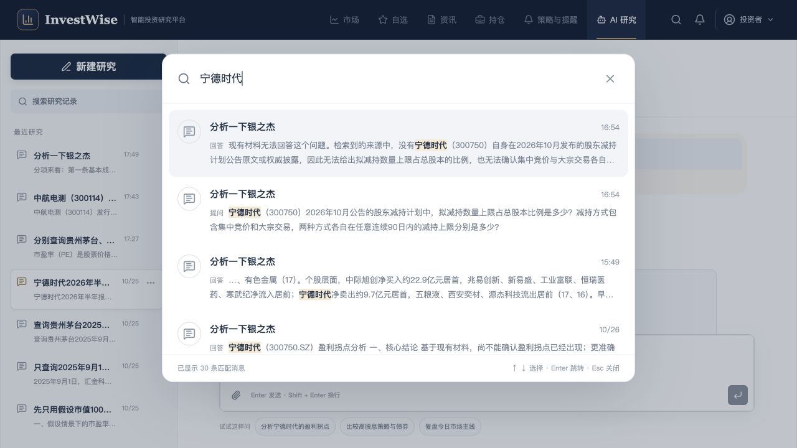
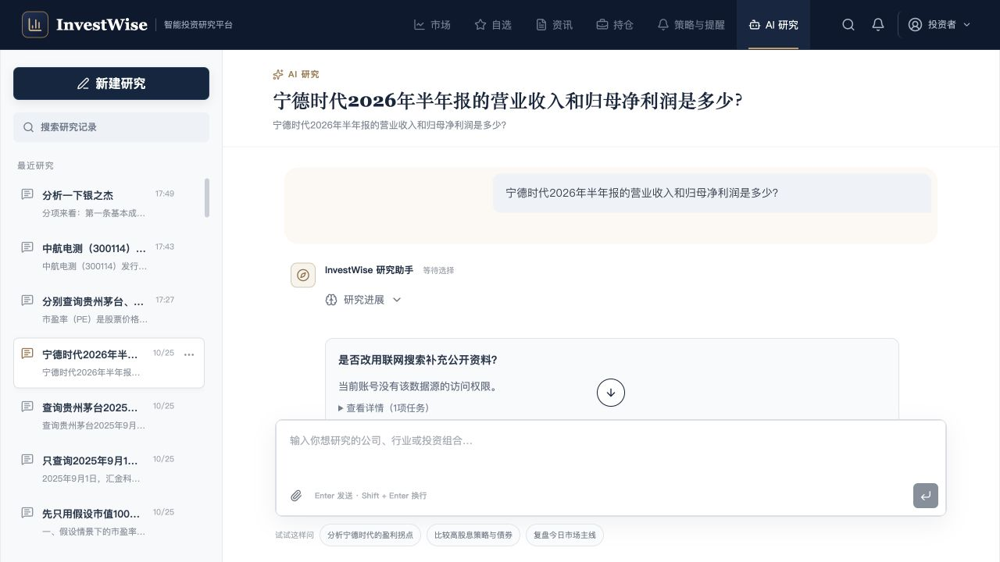

# 消息级搜索与聊天定位验收

## 已实现

- 侧栏改为搜索按钮，弹窗检索消息，最近会话列表不随关键词改变。
- 结果显示真实会话标题、时间、提问/回答、命中片段和关键词高亮。同一会话多条命中分别展示。
- 点击结果关闭弹窗并选择对应会话，滚动到目标消息、轻底色突出并转移焦点。较早历史按需逐页补齐。
- 搜索防抖、分页、失败重试、取消请求、空结果、方向键/Enter/Escape及关闭焦点恢复。
- 检索遵循用户、租户与删除边界；不会调用模型。

## 回归证据

`npm --prefix frontend test`：20 个文件，132 项通过。

`npm --prefix frontend run build`：通过；保留既有 Zod 注释、循环分包与大包提醒。

`.venv/bin/python -m pytest backend/app/tests/integration/test_session_api.py backend/app/tests/integration/test_session_message_search.py backend/app/tests/unit/test_conversation_service.py backend/app/tests/unit/test_conversation_repository.py -q`：162 项通过。

父子组件初始化竞态由真实页面集成用例覆盖：在初次历史加载尚未完成时禁止发分页；初始化返回第 401—600 条后，以 401、201 为游标补齐旧消息，目标第 100 条与最新第 600 条均保留，停止追底后聚焦目标消息。该用例先观察失败再通过。

页面验证使用现有真实历史，只读搜索“宁德时代”，展示 30 条匹配消息和高亮；选择提问条目后定位到该提问。另搜索“2026年半年报的营业收入和归母净利润”，选择另一个会话的命中，真实标题切换为“宁德时代2026年半年报的营业收入和归母净利润是多少？”，焦点及高亮定位到目标 message_id，目标顶部位于视口 222.5px。没有提交新问题、授权工具或删除用户会话。

