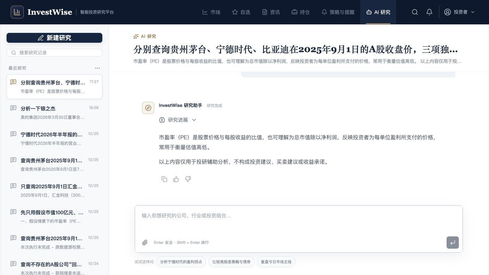

# 真实研究记录与提交定位验收

## 实现

- `GET /api/sessions` 增加 `title`、`preview`，从归属已校验的会话首条可见问题及最近非空消息生成，排除软删除消息，以一次批量查询读取摘要，不调用模型。
- 侧栏、标题区、聊天记录、附件共享选中的真实会话 ID。切换会话清理旧订阅及局部状态，保留后台任务；刷新恢复原选择，新建研究首次提问前为空白。
- 新问题立即进入列表并更新排序；回答完成（包括恢复执行的任务）重新读取真实摘要和更新时间。加载尾部历史不覆盖原始首问标题，也不修改会话排序。
- 移除三条预置研究及预置研究回答。保留原布局，长标题和摘要使用单行省略。
- 接受本地提交并插入用户消息后，使用与底部按钮相同的 `scrollToBottom`；助手增量更新不额外强制定位。

## 自动验证

- 前端完整测试：106 项通过。
- 前端 TypeScript 与生产构建通过；保留现有依赖注释、循环 chunk 与大包提示。
- 后端会话接口、会话仓库、持久运行接口：119 项通过。
- 仓库文件 Ruff 检查与 `git diff --check` 通过。接口及既有大集成测试文件仍有原有的 FastAPI `B008` 和四项既有静态检查问题，未扩大本次修改范围。
- 独立只读评审指出的长会话标题、软删除摘要、更新时间倒退及恢复任务摘要刷新问题均已修复，并增加回归测试。

## 浏览器验证

使用本地 5175 前端及 8000 后端现有数据验证：列表为真实会话；点击三只股票收盘价的历史记录后标题和聊天内容一致；向上滚动后输入“不要调用工具，请用一句话解释市盈率。”并按 Enter，页面立即滚动至新用户消息，列表即时置顶；回答完成后摘要更新为实际回答。刷新后原会话标题、摘要和最新回答正常恢复。

本次提交测试在选中的本地历史会话内增加了一轮问答。未提交 Git、更改部署或修改其他会话内容。

