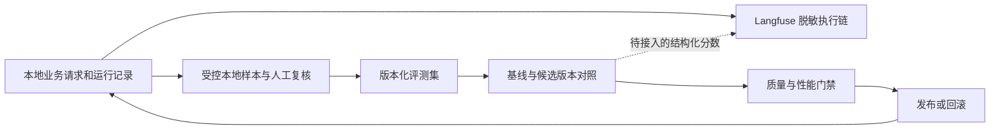

# Langfuse：Agent 与 RAG 集成、使用和优化闭环指南

适用项目：BsAgent，以及其调用的外部 RAG 服务（服务端方案待实施）。整理日期：2026-10-05。当前运行目标为本地 Langfuse 4.16.0（`http://localhost:3000`）和 Python SDK 4.16.0；2026-09-26 的 EU 验收仅保存在历史归档中，不代表当前配置。

阅读顺序：日常操作见第 2 节；Agent 集成见第 3 节；RAG 集成与专属闭环见第 4 节；数据边界、共同评测和实施顺序见第 5–9 节。

## 1. 先明确现在能做什么

Langfuse 用于回答“哪一步慢、哪次模型调用贵、哪条执行链出错”。要判断“回答是否正确、证据是否充分、工具是否选对”，还需要本地业务数据和评测。

| 能力 | 当前状态 | 使用方式 |
| --- | --- | --- |
| Agent → Graph → Generation 层级 | 已接入；需用 `--real-agent` 生成本机真实验收证据 | 按节点查看执行链、Token、耗时和 TTFT |
| 业务关联、session 摘要、初始/恢复执行标记 | 已接入；真实 smoke 只覆盖 initial | 用 business_trace_id 对照本地 AgentRun；恢复场景另做集成验收 |
| DeepSeek 成本 | 本地项目可配置模型价格定义 | 仅作为估算，不作为账单；静态价格需要维护 |
| Trace 的 input/output 内容 | 本地受控项目允许合成或经审查的内容 | 不得包含密钥、Authorization、Cookie 或不应进入本机的用户数据 |
| 七类 Scores、规则与 DeepSeek evaluator | 本地工作流提供固定名称、规则计算和可选 DeepSeek Judge | 区分规则分与 Judge 分，保存 evaluator/rubric/dataset/run 版本 |
| 两个 Human Annotation queue | 本地工作流提供创建/复用和待复核入队 | `answer-quality-review` 与 `skill-tool-selection-review` |
| Prompt、Dataset、Experiment | 本地工作流提供版本化 Prompt、稳定 Dataset 项和顺序 Experiment | 固定样本对照版本，形成优化闭环 |
| Alerts、Playground | 本轮不做 | 不作为当前运行步骤或验收前置条件 |

[本地接入与字段说明](langfuse-local-observability.md)记录配置细节；[历史验收归档](acceptance/archive/2026-09-26-langfuse-eu-smoke.md)记录已有证据与覆盖边界。Scores、Datasets、Experiments 与人工队列、Prompt 一起构成本地评估工作流。[官方评测概念](https://langfuse.com/docs/evaluation/core-concepts)

## 2. 日常怎么使用

### 2.1 配置和启动

当前项目目标运行本机 Langfuse 4.16.0；实际版本以健康接口和真实 smoke 的 `server_version_observed` 为准。确认以下配置，不要重新复制模板覆盖已有密钥：

```dotenv
BS_AGENT_LANGFUSE_ENABLED=true
BS_AGENT_LANGFUSE_BASE_URL=http://localhost:3000
BS_AGENT_APP_ENV=local
BS_AGENT_LANGFUSE_SAMPLE_RATE=1.0
```

Langfuse public/secret key 与 DeepSeek key 只放在本地配置或 Secret Manager。endpoint 固定指向本机服务，shell 环境变量优先于 `.env.local`。本地服务启动方式见[本地观测说明](langfuse-local-observability.md)。

```bash
# 启动本地平台后运行合成平台探针，不作为 DeepSeek usage/成本证据。
.venv/bin/python langfuse/smoke.py

# 显式运行真实 Agent Graph + DeepSeek；会产生少量模型费用。
.venv/bin/python langfuse/smoke.py --real-agent \
  --output docs/acceptance/2026-10-05-langfuse-local-real-smoke.json

# 独立合成 reasoning canary 验证。
.venv/bin/python langfuse/smoke.py --debug-reasoning

# 两个人工标注项目完成后，核验 queue 状态和人工 Score。
.venv/bin/python langfuse/smoke.py --verify-human-annotation

# 日常启动，仍需满足原有数据库等依赖。
npm run dev:backend
```

默认 smoke 使用合成 observation；`--real-agent` 才使用真实业务 Graph 和 DeepSeek，并在 Graph 内运行受控本地 RAG/只读工具探针。两者都不代替 HTTP API、PostgreSQL、审批恢复或生产可用性验收。真实脚本若返回 `blocked=true` 或任一必需 check 为 false，结论只能是“尚未通过”，不得引用合成探针声称真实验收完成。

### 2.2 找到一条请求

1. 从业务响应、会话详情或本地运行记录取得业务 `trace_id`。
2. 打开 `http://localhost:3000`，进入本地项目的 Traces/Observations 列表，按请求时间和 `local` environment 缩小范围。
3. 查找根 `bs-agent.run` 的 metadata：`business_trace_id` 应与业务 ID 一致。若界面不便按根 metadata 筛选，可用受控脚本按业务 ID 确定性派生 Langfuse trace ID，再通过 v2 API 查询。两种 ID 不能直接混用。
4. 展开 `LangGraph`，定位 `intent_router`、`planner_agent`、`tool_agent`、`synthesizer` 等节点以及其 Generation。
5. 记录“业务 ID、异常节点、指标、版本、问题分类”，不要把业务正文复制到 Trace metadata 或评论中。

UI 菜单可能变化，以实体和字段为准。程序化查询使用 Observations API v2，必须请求所需的 `io`、`metadata`、`usage`、`model`、`metrics` 等字段，并限制时间范围、处理分页；未请求的字段缺失不能视为“已确认空”。[官方查询说明](https://langfuse.com/docs/api-and-data-platform/features/observations-api)

### 2.3 看什么，不要误读什么

| 观察项 | 能判断什么 | 不能据此判断什么 |
| --- | --- | --- |
| 根与节点耗时 | 时间主要花在哪里 | 子节点有嵌套/并发，耗时不能简单相加 |
| Generation TTFT | 收到首个 content 或 reasoning delta 的等待时间 | 不是用户首个可见答案的等待时间；后者需单独埋点 |
| latency − TTFT | 后续生成与传输的持续时间 | 不能仅凭此区分网络慢还是模型生成慢 |
| input/output/total Token | 上下文和生成规模 | Token 多不等于质量高 |
| reasoning_chars | reasoning 的字符数量 | 无法看到思考内容，也不能用字符数换算精确 Token |
| level/statusMessage、重试次数 | 单次尝试失败与重试情况 | 某个 Generation ERROR 不等于整个业务运行失败 |
| root metadata、session 摘要 | 与业务记录和会话关联 | Trace metadata 不含原始用户、租户、会话标识 |
| 成本字段 | 当前模型定义下的估算 | 不等于 DeepSeek 实际扣款 |

业务成功以 AgentRun 最终状态和业务结果为准，不要把“模型 HTTP 200”或“trace 没红色节点”当作成功。

### 2.4 常见问题的操作顺序

| 症状 | 先核对 | 后续动作 |
| --- | --- | --- |
| 看不到 trace | 开关、本地 endpoint 与 keys、environment、采样率、flush | 跑 smoke；观测故障不能阻断业务 |
| 回答很慢 | 根耗时 → 最慢路径 → Generation TTFT/输出量 → 重试 | 在固定样本上验证一个性能假设 |
| Token/成本高 | 输入膨胀、重复调用、planner 迭代、错误重试 | 先确定浪费在哪，再改上下文或调用策略 |
| 工具调用成功但答错 | 本地工具选择、参数、证据、最终答案 | 进入质量评测闭环，耗时数据无法判定语义正确 |
| Token 有值但成本为空 | 模型名称、价格定义、生效日期 | 修正本地项目模型定义后发新请求核对，不假定旧记录自动重算 |
| 出现正文或原始标识 | 停止继续上传并记录 trace ID | 修复脱敏、补 canary 回归、复验后恢复 |

## 3. Agent 如何集成和使用 Langfuse

### 3.1 在哪一层接入

Agent 观测关注“如何完成任务”：理解目标、制定计划、选择工具、执行/审批、校验和生成最终答案。Langfuse SDK 管理 observation，官方 LangChain CallbackHandler 管理 Graph 内可识别的调用；业务代码负责根、关联字段和数据边界。

| 接入位置 | 本项目入口 | Langfuse 中应该看到什么 | 当前状态 |
| --- | --- | --- | --- |
| 服务生命周期 | `backend/app/operations/langfuse_observability.py` | 独立 provider、环境、采样、脱敏、退出 flush | 已实现 |
| 一次 Agent 执行段 | `backend/app/graph/runtime.py` 的 `langfuse_agent_run` | `bs-agent.run`，业务 trace ID、session 摘要 | 已实现 |
| Graph 执行 | 官方 CallbackHandler 加入 invoke/stream config | Graph 和节点的父子层级 | 已实现 |
| 自定义 DeepSeek HTTP 客户端 | `backend/app/llm/deepseek.py` | GENERATION：模型、参数、usage、TTFT | 已实现 |
| 工具执行 | Tool Agent / 执行网关与官方回调 | TOOL：名称、状态、耗时；受控参数/结果按 `local_content` 脱敏后记录 | 需逐个执行路径验证；smoke 只证明受控只读路径 |
| 任务质量与用户反馈 | 本地业务结果 → 七类 Score 与人工复核队列 | 与 trace/observation 关联的规则分、Judge 分及人工分 | 本地工作流已纳入 |

已有 Agent 接入的简化形式如下，说明位置，不要再复制一套根节点包装已有 runtime：

```python
with langfuse_agent_run(
    business_trace_id=state["trace_id"],
    session_key=state["session_key"],
    tenant_id=state["tenant_id"],
    execution_segment="initial",
) as callbacks:
    result = graph.invoke(state, config={"callbacks": list(callbacks)})
```

实际实现还要保留 checkpoint、recursion limit 和其他 callback 配置。直接 HTTP 调用模型时，在当前节点上下文内创建 `generation` 并更新 provider usage；不要认为 LangChain callback 会自动识别所有自定义 HTTP 客户端。反过来，同一次模型调用如果已由 callback 生成 observation，就不要再包一个重复 generation，防止重复统计成本。

初始执行的 smoke 是一个业务根；审批恢复复用确定性 trace ID，但会创建 `execution_segment=resume` 的执行段。不要把“整条 trace 永远只有一个 root observation”写成恢复场景的验收条件。应按 AgentRun 和执行段解释，分别核对业务执行时间和人工等待。

### 3.2 用 Langfuse 定位 Agent 问题

例如“查公司信息 → 查询知识库 → 汇总风险”的任务：

1. 先看 AgentRun 最终状态，再看 Graph 走了哪些节点，是否反复规划或提前结束。
2. 看 planner 的调用次数和 output Token，判断是否出现无收益的反复迭代。
3. 看工具是否被执行；再在本地检查该工具是否应该被选择、参数是否正确。Trace 中记录的工具名只能说明发生了什么，不能证明选得正确。
4. 若工具与证据正确而答案错误，检查 synthesizer 的本地输出及引用；若没有拿到证据，优先处理检索/工具阶段。
5. 在本地评测后，将 `task_success` 关联整条 trace，将 `selection_correctness` 关联具体工具决策对应的 observation；已有 Score 名称按七类稳定定义使用。

### 3.3 Agent 专属优化闭环

评估阶段提供七个稳定 Score：`task_success`、`answer_quality`、`groundedness`、`selection_correctness`、`citation_coverage`、`action_policy_compliance`、`review_outcome`。规则 evaluator 负责可确定的完成、引用覆盖、选择和策略检查；DeepSeek evaluator 只产生结构化质量/groundedness 判断，失败时记录失败状态而不伪造低分。`answer-quality-review` 复核 Trace，`skill-tool-selection-review` 复核具体选择 observation。低分、失败、规则/Judge 分歧和抽样项目可进入待处理队列。

`Prompt` 按标签读取并关联 Generation；Dataset 使用稳定 ID 和版本保存合成/审查过的输入、期望输出及约束；Experiment 在同一 Dataset 上顺序运行固定配置，分别计算规则结果和可选 DeepSeek 评估。每次优化比较相同样本上的七类 Score、时延与 Token，将失败样本补回 Dataset。示例入口为 `.venv/bin/python scripts/langfuse_examples.py prompt|dataset|experiment`，Judge 实验可追加 `--with-deepseek`。

| 闭环 | Langfuse 提供的证据 | 本地补充判断 | 修改后怎样验收 |
| --- | --- | --- | --- |
| 意图路由 | intent_router 的耗时、模型调用与失败 | 预测意图是否与标注一致 | 固定集路由准确率；范围外请求不能误入业务流程 |
| 规划与停止 | planner 调用次数、执行链、Token | 是否重复任务、遗漏步骤或过早停止 | 任务完成率不降，冗余步骤/循环减少 |
| 工具选择与执行 | 工具/Generation observation、错误与耗时 | 工具是否正确，权限/审批是否正确执行 | 正负样本均通过，越权执行为零 |
| 答案综合 | synthesizer latency、Token、成本 | 事实、引用、任务要求满足情况 | 本地质量分不降，严重错误不新增 |
| 恢复与可靠性 | initial/resume 执行段、重试轨迹 | 业务状态、checkpoint、工具副作用 | 不重复写入，恢复不丢步骤，超时可诊断 |

Agent 优化的首要目标是任务完成和动作正确，不是盲目减少节点或 Token。

## 4. RAG 如何集成和使用 Langfuse

### 4.1 本项目的 RAG 边界

当前 `backend/app/tools/rag_search.py` 是 **RAG 服务的调用方**：通过 `POST /api/rag/retrieve` 发送 query 和检索配置，接收 contexts、分数和服务端时延，再供 Agent 使用。此接口是检索接口，不应假设它也完成最终回答生成；当前 Agent 的 synthesizer 承担答案综合。

已核对的调用配置包括 `topK/contextLimit`、hybrid、rerank、queryRewrite、graphRag。**调用方有参数不等于服务端已实现并生效**；必须通过服务端阶段观测和契约测试确认。当前 payload 对 hybrid 做布尔映射，不能据此断言 semantic/keyword 已完整区分。

当前该文件没有显式传递 Langfuse 父 observation 上下文，也没有 RAG 内部阶段埋点。返回 ToolCallResult 中自行生成的业务 `trace_id` 不是下游 Langfuse trace ID，不能拿它来证明跨服务调用已经连通。本文未检查外部 RAG 仓库内部实现，下列服务端阶段均为建议接入方式。

### 4.2 两层集成，按顺序完成

**第一层：Agent 侧 RAG 调用。** 在真实工具执行路径确认 `rag_search` 的 TOOL observation；若该路径未触发官方工具 callback，在执行网关显式添加一个 observation，不要重复。记录总耗时、结果数、检索模式、top_k、稳定错误码、RAG 配置版本。在 `local_content` 下，经批准的 query、chunk 和工具结果可经统一内容策略脱敏、截断后进入本地 Langfuse；凭证、reasoning、文件/二进制正文和未经批准的真实数据仍不得进入。

**第二层：RAG 服务内部。** RAG 服务初始化自己的官方 SDK/client 与安全导出策略，在入口建立 `rag.retrieve`，再对实际存在的阶段分层：

```text
bs-agent.run
└── LangGraph
    ├── tool_agent
    │   └── rag_search                    TOOL，Agent 侧调用
    │       └── rag.retrieve              RETRIEVER，RAG 服务入口
    │           ├── query_rewrite         GENERATION，仅在调用 LLM 时
    │           ├── query_embedding       EMBEDDING，仅在计算 embedding 时
    │           ├── candidate_retrieval   RETRIEVER，可再分向量/关键词召回
    │           ├── rerank                SPAN，模型适配另行验证
    │           └── context_assembly      SPAN，去重/截断/拼装
    └── synthesizer
        └── answer_generation             GENERATION，最终回答
```

这是**目标层级示意，不是当前已实现的完整链路**。只有调用 LLM 才记 generation，普通向量查询/重排耗时不要伪造 LLM usage；embedding/rerank 的成本仅在 provider 或价格定义可靠时记录。若独立 RAG 产品自带回答接口，则 answer_generation 放在该 RAG 请求下；不要同时在 Agent 和 RAG 重复计算同一次生成。

每个服务都要设置本地项目、环境和独立的数据边界策略。Agent 侧的 masking 无法替 RAG 服务删除其自行导出的正文。只给 Agent 安装 callback，不会自动获得 HTTP 另一端的内部 span。

### 4.3 跨服务 trace 如何关联

推荐 Agent 与 RAG 使用同一本地项目中的一致追踪上下文：

1. 发起 RAG HTTP 请求时，取得**当前 rag_search observation 的 OTel trace/span 上下文**，而不是业务 UUID。
2. 使用 W3C trace context 的 inject/extract 在可信内部请求上透传，RAG 建立该上下文的子 observation；也可以按官方 SDK 的显式 `trace_context` 方式传入 trace_id/parent_span_id。两种方案择一明确实现并测试，不要混杂多个 provider 的上下文。
3. business_trace_id 作为允许的业务关联 metadata 保留。只传已筛选的非敏感 baggage，不透传用户正文、原始身份或任意请求头。
4. 服务边界校验来源与 ID 格式，追踪头不是认证/授权凭证；RAG 的租户隔离和访问控制仍由可信认证上下文决定。
5. Agent/RAG 采样和导出策略协调，验证同一 traceId、父 ID 存在、节点没有串到并发请求。缺失父节点可能来自采样或导出，不要仅凭一个 span 就归咎检索服务。

若暂时不能共享项目或上下文，可以先保留两条 trace，通过明确的关联 ID 做本地查询对照；这只是跨服务关联，不能声称已经形成一棵完整调用树。官方支持观察上下文与属性传播，具体接入应以安装版本验证。[官方 SDK 埋点与传播说明](https://langfuse.com/docs/observability/sdk/instrumentation)

### 4.4 RAG 应上传哪些字段

| 阶段 | 推荐非内容字段 | `local_content` 对正文的处理 |
| --- | --- | --- |
| 请求入口 | 请求/配置版本、检索模式、top_k、状态码 | 经批准的 query/filter 值脱敏、截断后可进入；原始身份删除 |
| 查询改写 | 是否启用、模型、usage、耗时 | 经批准的原查询和改写查询脱敏、截断后可进入 |
| 召回 | 候选数量、模式、索引/embedding 版本、耗时 | 经批准的 chunk 内容脱敏、截断后可进入；文件路径和敏感文档 ID 删除 |
| 重排 | 候选/保留数量、重排模型版本、耗时 | 经批准的 query/chunk 配对脱敏、截断后可进入 |
| 上下文拼装 | 去重数量、截断数量、上下文字符/Token 数 | 经批准的上下文脱敏、截断后可进入，不上传文件/二进制正文 |
| 回答 | 模型、usage、TTFT、成本、结构化分数 | prompt、回答脱敏、截断后进入；reasoning 默认删除 |

以上新字段需要专门的白名单与类型/枚举校验，目前不会自动通过 BsAgent metadata 白名单。文档/chunk 标识如确需关联，优先采用项目命名空间下不可反查的受控标识；本地维护映射，不能把 sourcePath 当作天然安全字段。

离线建库也值得观测：解析、切分、embedding、写索引建立独立 ingestion trace，记录 corpus/index/chunking 版本、数量、失败与耗时。通过版本将它与在线查询实验关联，不要把整次建库挂在每条用户查询下面。

### 4.5 RAG 的五个优化闭环

| 闭环 | 固定什么、比较什么 | 指标与 Langfuse 落点 | 通过条件 |
| --- | --- | --- | --- |
| 文档治理/切分 | 固定问题集，对照语料或 chunking 版本 | 本地证据覆盖；ingestion 与检索 observation 的版本/耗时 | 已知答案能被找到，更新/删除文档不会残留错误证据 |
| 查询改写/召回 | 固定语料快照，对照改写、embedding、检索模式/top_k | recall@k、hit@k、MRR，Score 关联召回 observation | 相关证据召回改善，延迟与噪声在预算内 |
| 重排/上下文 | 固定召回候选，对照 rerank、去重和截断 | nDCG@k/precision@k、上下文长度、阶段耗时 | 重要证据保留、噪声减少，不因截断丢关键结论 |
| 生成/引用 | 固定问题及检索上下文，对照生成 prompt/模型 | 事实正确性、faithfulness、引用支持率，Score 关联 generation | 答案有依据，证据不足时不编造 |
| 端到端 | 固定评测集，重跑完整管线 | RAG 任务成功率、p95、成功任务成本，Score 关联请求根 | 局部指标变好后，最终答案确实改善且无权限退化 |

recall@k 需要标注相关证据集合；hit@k 只判断是否至少命中一条，不能互相替代。chunking 改变时 chunk ID 不稳定，应按文档/证据片段语义对齐 gold labels，不能机械比较旧 chunk ID。

faithfulness 判断答案是否受给定上下文支持，**不证明上下文本身真实或最新**，因此还需事实正确性、来源时效与权限隔离检查。可在受控本地接 Ragas 或自定义评测器，本地 Langfuse 记录分数；若评测器调用外部模型，其正文传输也必须满足原有数据边界。[Langfuse 与 Ragas 集成](https://langfuse.com/integrations/frameworks/ragas)

### 4.6 Agent + RAG 联合排障例子

用户反馈“年报分析遗漏某项风险”，按顺序检查：

1. **没有调用 RAG：** 查 Agent 的意图/工具选择，不先调 embedding。
2. **调用了但未召回证据：** 查语料是否入库、权限过滤、改写和召回，补 retrieval case。
3. **召回有证据但重排/拼装丢了：** 查 rerank、去重和 context limit，补 context case。
4. **上下文保留了证据但回答遗漏：** 查 synthesizer 与引用，补 generation case。
5. **独立 RAG 测试通过但 Agent 仍失败：** 查 Agent 是否改错 query、忽略工具结果或提前停止，补完整 Agent case。

针对定位到的一层修复，先跑该层评测，再跑 Agent + RAG 端到端保留集；同一 case_id、实验版本和业务 trace 关联起来，才形成联合闭环。

## 5. 当前数据边界决定评测应放在哪里

推荐采用“**本地保留受控样本与 Trace 内容、本地执行评测、按权限关联结构化结果**”的方式。



本地受控 Langfuse Trace 可以用于开发排障；Dataset/Experiment 应使用稳定、审查过的样本和期望结果，不能将 Trace 原样复制后假定其已满足评测要求。DeepSeek Judge 输入也应限定在获准的数据范围内。

上传结构化 Score 时，使用 trace/observation 关联标识、评分名称、数值、原因枚举、评测器版本。自由文本评语、评分理由、expected output 也可能泄漏正文。**当前 span 脱敏钩子不等于 Score/Dataset/Prompt API 的脱敏保证**，这些入口接入前需要独立测试。

本地 `/api/traces/{trace_id}` 受权限和租户限制；trace artifacts 还受采样、截断和保留策略约束，并非一定能恢复全部输入。对无法重放的线上问题，应由有权限人员整理最小脱敏复现样本，不应为评测无限扩大内容采集。

## 6. 先建立可比较的基线

建议先准备 30–50 条代表性样本，作为启动规模而非统计充分性的承诺。至少覆盖：寒暄/范围外、意图识别、单工具、多步骤、无证据、工具超时、权限拒绝、审批恢复、长上下文。

每条本地样本记录：稳定 case_id、场景、受控输入引用、预期任务结果、允许/禁止的工具、关键证据或判断规则。训练/调优样本和保留验收集分开，新增线上失败样本后递增数据集版本。

每次实验固定数据集、工具目录/数据快照、模型和采样条件，记录以下版本：

- commit、prompt revision/hash、模型配置；
- dataset version、evaluator version；
- 工具目录/检索配置版本、运行环境与实验 ID。

这些版本字段应保存在 Experiment metadata 和本地实验清单中；仅添加调用侧 metadata 不代表 SDK 或服务端已接受，需通过本地 4.16.0 回读确认。

每个指标保留分母、样本数与场景切片。少量样本的 p95 不稳定；可先看配对结果和分布，积累更多代表性运行后再设正式 SLO。对有随机性的调用做重复实验，报告波动，不能凭单条 smoke 判断优化有效。

## 7. 接下来必须做的六个闭环

以下均是建议待办，建议门槛需基线数据验证后定稿。

### 闭环一：反馈 → 失败样本 → 质量回归（P0）

**问题入口：** 用户负反馈、人工抽检失败、错误答案、无证据结论。

**需要建设：** 按 business_trace_id 关联人工反馈；维护原因枚举，如 intent_wrong、wrong_tool、unsupported_claim、missing_evidence；将问题转成可复现样本和明确评分规则。前期人工本地登记即可，不必先开发完整反馈页面。

**如何优化：** 定位是路由、规划、工具还是答案综合的问题，一次修改一个主要因素。在相同数据集上比较基线和候选，失败案例必须复测。

**核心指标：** 任务完成率＝满足预期结果的样本/有效样本；证据支持率＝有证据支持的可核查主张/抽检主张；严重错误数；反馈覆盖率。分母为零记为 N/A，不记为 100%。

**闭环完成标准：** 每项修复都有失败 case、基线/候选结果和版本；关键场景不能因总体均分上升而退化。若引入 LLM 裁判，先用人工双评样本校准，固定裁判版本；外部裁判的数据传输另行审查。

**项目特别注意：** `verifier.py` 当前主要检查免责声明、禁止措辞和空答案，`faithfulness_score` 是 verdict 转成 0/1，并未验证事实与证据。不能把它命名为已完成的事实忠实度评测。`EvalHook` 也只是结果记录器，不是完整实验平台。

### 闭环二：慢 trace → 瓶颈假设 → 性能对照（P1）

**问题入口：** 某类任务端到端耗时高、首字慢、超时/重试多。

**需要建设：** 按任务类型建立端到端 p50/p95、Generation TTFT、用户首个可见输出延迟、节点调用次数基线。保留初始执行和审批恢复的区别；人工审批等待不并入模型推理时延。

**如何优化：** 输入过长时检查上下文裁剪；输出耗时高时检查输出长度与 thinking 策略；重复串行调用时检查规划和重试。只有独立任务才考虑并行。以上是候选方案，必须由 trace 和实验支持。

**闭环完成标准：** 在相同质量门槛下，目标场景有稳定改善。例如先试用“p95 下降至少 20%，质量不退化”作为实验目标，不能直接当作已验证 SLA。发布后观察相同场景是否维持收益，否则回滚。

### 闭环三：贵请求 → Token/价格归因 → 单成功任务成本（P1）

**问题入口：** 每条成功任务成本上涨、输出量增加或重试浪费。

**需要建设：** 按节点和任务类型统计 Token、调用次数、失败重试消耗；维护模型别名、生效日期和价格来源。历史 2026-09-26 EU 价格配置仅属旧验收事实；本地项目应按当前价格定义和生效日期计算估算，不能当作真实账单。

**如何优化：** 去掉重复上下文、缩短无用输出、减少重复检索/规划，再比较模型或 thinking 配置。若要支持缓存分价，应映射供应商已知且互不重叠的 usage 桶，防止将缓存 Token 与完整 input 重复计费，并补转换测试。

**核心指标：** 每成功任务成本＝同一批任务全部调用成本（含失败/重试）/成功任务数；input/output Token 分布；成本覆盖率＝有合法成本定义的 Generation/全部 Generation。

**闭环完成标准：** 固定质量和任务构成后成本下降，且知道差异来自 Token 变化还是价格表变化。前后对照使用同一价格口径；真实账单对账单独验收。不要通过多拒答来制造“更便宜”。

### 闭环四：工具/检索失败 → 阶段归因 → 检索与执行回归（P1）

**问题入口：** 找不到工具、选错工具、参数不合法、返回无证据、重复调用或工具不可用。

**需要建设：** 区分候选召回、工具选择、参数校验、授权、执行、证据利用六个阶段。Trace 中记录必要阶段与内容以支持本地调试，凭证和不应收集的数据仍须排除。

**现成入口：** 先使用 `backend/app/tests/evals/tool_search_cases.json` 与 `test_tool_search_quality.py`，将新问题加入已有工具检索评测，而不是另建重复体系。

```bash
# 使用安装了 dev 依赖的 Python。
python -m pytest backend/app/tests/evals/test_tool_search_quality.py -q
```

**核心指标：** 候选 recall@k、工具选择正确率、参数校验通过率、授权拒绝是否符合预期、执行成功率、最终任务成功率。正常的权限拒绝不能简单计为工具缺陷；HTTP 成功也不代表工具选择正确。

**闭环完成标准：** 修复所在阶段指标改善，并且权限隔离、写操作审批、负样本和端到端任务结果不退化。

### 闭环五：候选版本 → 评测门禁 → 发布后复核/回滚（P2）

**问题入口：** prompt、模型、planner、工具目录或 SDK 的任何行为变更。

**需要建设：** CI 执行单测、固定集评测和隐私测试；先人工审批评测报告，再逐步接自动门禁。为每个候选保留 commit/配置引用及上一稳定版本的恢复方式。Prompt Management 是可选的后续能力；Prompt Management 纳入本地工作流；确认模板内容符合本机项目的数据处理范围，并记录 prompt 版本。

**建议门槛：** 关键权限/审批/隐私用例零退化；质量不低于约定基线；性能和成本在预算内。缺失必需评测结果应视为“未完成验收”，不能静默通过。

**发布后动作：** 项目尚未启用生产 Langfuse，先补 HTTP/PostgreSQL/恢复链路和生产数据边界验收。本轮 Alerts 与 Playground 不实施。具备发布条件后，以相同任务类型、样本量和价格口径比较发布前后；触发门槛则回滚，再把回归加入数据集。单纯“合并代码后看一眼面板”不算闭环。[官方评测与 CI 能力](https://langfuse.com/docs/evaluation/overview)

### 闭环六：观测异常/泄漏风险 → 安全回归 → 可信指标（贯穿各阶段）

**问题入口：** trace 丢失、父子关系异常、usage 缺失、价格缺失、敏感字段出现、SDK 升级。

**需要建设：** 将真实 smoke、脱敏 canary 和脱敏边界单测纳入接入变更验收；核对受控批次中预期采样与实际导出数量；注入 本地观测服务不可达场景，验证业务仍能完成。

**核心指标：** 对受控且确认被采样的运行统计 trace 完整率、usage 覆盖率、成本覆盖率、敏感数据泄漏数。随机采样后的 trace 不能直接代表全量业务成功率，需对照业务库的分母；也不要假设当前系统自动全量保留错误 trace。

**闭环完成标准：** 业务完成、层级和关联正确、内容边界通过、故障不影响业务。新增 Score/Dataset/Prompt 通道必须各自测试；不能用既有 smoke 覆盖它们。

## 8. 推荐实施顺序与交付物

| 顺序 | 做什么 | 交付物 | 完成后能回答的问题 |
| --- | --- | --- | --- |
| 第一步 | 固定基线、版本清单和问题分类 | 本地代表性 Dataset、七类 Score 规则、一次基线 Experiment 报告 | 现在究竟哪里不好？ |
| 第二步 | 建立人工反馈与失败样本回归 | trace → issue → case → 修复结果的关联表 | 同类问题是否还会再犯？ |
| 第三步 | 对最高频/最高损失问题做单因素实验 | 一份质量/时延/成本配对对照报告 | 这次修改真的更好吗？ |
| 第四步 | 接结构化 Scores 与非敏感版本字段 | 独立脱敏测试、可追溯本地分数 | 能否按版本跟踪效果？ |
| 第五步 | 补业务集成验收与发布门禁 | API/PostgreSQL/恢复证据、回滚记录 | 能否安全发布并持续保持收益？ |

优先完成前两步；不要一开始同时建设 Prompt Management、自动裁判、本地 Dataset 和复杂面板。观测接通后的下一项最有价值工作是“**有代表性数据集、有明确评分规则、有基线**”。

## 9. 每轮优化使用的记录模板

```text
问题 ID / owner：
关联 business_trace_id / 发生时间 / 场景：
问题分类与本地受控证据引用：
根因假设：
唯一主要修改：
基线 commit / 候选 commit：
dataset / evaluator / prompt / model / tool catalog 版本：
样本数、重复次数、纳入和排除规则：
主要指标（基线 → 候选）：
质量、权限、隐私护栏结果：
价格口径与成本覆盖率：
是否通过 / 发布或不发布的理由：
发布后复核窗口与样本量：
回滚条件与上一稳定版本：
回归 case_id / 最终结论：
```

一轮优化只有在“问题可复现、修改有证据、退化可拦截、结果可追溯”时才算完成。发现更慢、更贵或更差的候选并拒绝发布，同样是有效的闭环结果。
