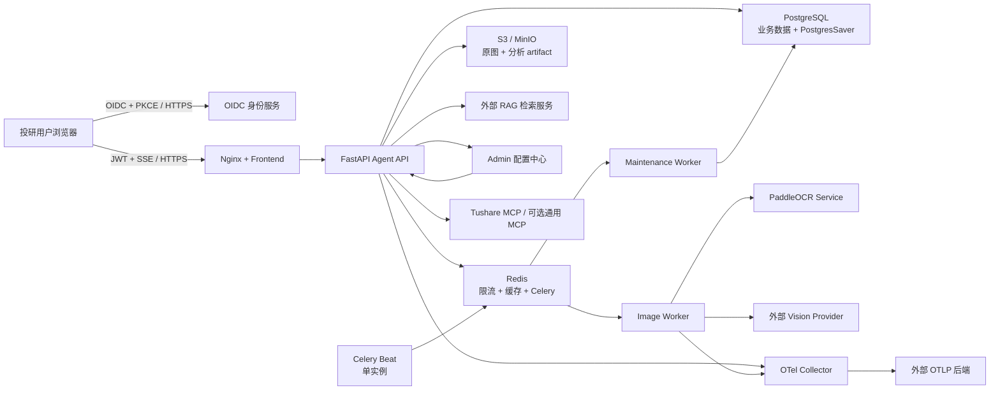

# 生产部署与运维手册

## 1. 部署边界

`compose.production.yml` 提供单机生产基线，适合预生产、内网部署和首版受控发布。它验证了服务依赖、迁移顺序、非 root 运行、健康探针、数据卷和运行时配置，但不提供跨节点容灾。高可用部署应沿用同一镜像和环境变量契约，将 PostgreSQL、Redis、S3、身份服务和 OTLP 后端替换为托管或集群化服务。



## 2. 上线前置条件

- Docker Engine 与 Docker Compose v2。
- 可访问的 OIDC/JWT 身份服务，支持 Authorization Code + PKCE 和 JWKS。
- 可访问的 RAG、Admin、Skill Registry、DeepSeek、Vision 和 OTLP 后端。
- 生产密码与 API Key 由 Secret Manager 或部署平台注入，不提交到 Git。
- 对外入口必须使用 HTTPS；Nginx 容器只负责应用代理，TLS 建议在负载均衡器或 Ingress 终止。
- PostgreSQL、Redis 和对象存储必须启用备份、监控与访问控制。

## 3. 身份与权限契约

浏览器使用 `oidc-client-ts` 完成 Authorization Code + PKCE，不配置 `client_secret`，令牌只保存在 `sessionStorage`。OIDC 运行时公共配置由容器启动脚本生成，不会写入前端构建产物。

身份服务签发给 API 的 access token 至少包含：

| Claim | 作用 |
| --- | --- |
| `iss` | 必须等于 `JWT_ISSUER` |
| `aud` | 必须严格等于 `JWT_AUDIENCE` |
| `exp` | 令牌过期时间 |
| `sub` | 用户标识 |
| `tenant_id` | 租户边界 |
| `scope` 或 `scopes` | 空格分隔字符串或字符串数组 |
| `jti` | 可选，用于审计和撤销关联 |

普通分析师通常需要 `agent:invoke`、`rag:retrieve`、`asset:write`、`asset:read`、`asset:delete` 和 `trace:read`。工具所需 scope 由动态发现的工具定义决定。管理员可使用 `*`，但不应向普通用户签发通配权限。

在身份服务登记以下回调：

- 登录回调：`${PUBLIC_BASE_URL}/auth/callback`
- 退出回调：`${PUBLIC_BASE_URL}/`
- Allowed Web Origins：`PUBLIC_BASE_URL`

`OIDC_CONNECT_SRC` 必须是身份服务的纯 origin，并进入前端 CSP 白名单。`OIDC_SCOPE` 应配置为身份服务中能够产生上述 API scopes 的授权范围。

## 4. 配置 Secret

```bash
cp deploy/production.env.example deploy/production.env
chmod 600 deploy/production.env
```

必须替换所有 `replace-with-*`。`POSTGRES_PASSWORD_URLENCODED` 与 `REDIS_PASSWORD_URLENCODED` 用于 URL，密码包含 `@`、`:`、`/`、`%` 等字符时必须百分号编码。以下 revision 不能使用 `local-dev` 或 `default`：

- `RAG_PROVIDER_REVISION`、`RAG_CONFIG_REVISION`
- `OCR_PROVIDER_VERSION`

这些字段会进入运行上下文和 Trace，用于审计、问题回放与灰度对比。

Tushare 官方 Streamable HTTP MCP 完整 URL 由管理员在 Admin 的“市场数据源”页面保存并激活。Agent 通过 `ADMIN_BASE_URL` 读取当前连接后直连 Tushare；生产 Compose 不读取 `TUSHARE_TOKEN`，也不构建、启动或依赖仓库内的学习示例 MCP Server。

`BS_AGENT_MCP_SERVER_URL`、`BS_AGENT_MCP_SERVER_NAME`、`MCP_SERVER_REVISION` 和 `MCP_CONFIG_REVISION` 只用于额外的通用 MCP Server。未配置通用 MCP 时 URL 保持为空，其 revision 可以保留默认值；一旦配置生产通用 MCP，revision 必须改为可审计的非开发版本。

Admin Backend 的内部接口会向 Agent 返回完整 MCP URL，因此必须只在服务网络内开放。面向浏览器的 Admin 列表和详情接口返回脱敏地址。

## 5. 构建与启动

Python 生产镜像分别使用 `backend/requirements.lock` 与 `ocr-service/requirements.lock` 固定完整依赖版本，并在构建时执行 `pip check`。升级 Python 依赖时必须在 Python 3.11 环境重新生成对应锁文件，随后执行全量测试、镜像构建与 OCR 实图回归；不要只修改 `pyproject.toml` 而保留旧锁文件。

先展开 Compose，确认没有缺失变量：

```bash
docker compose --env-file deploy/production.env -f compose.production.yml config --quiet
docker compose --env-file deploy/production.env -f compose.production.yml build
docker compose --env-file deploy/production.env -f compose.production.yml up -d
```

`migrate` 服务先执行 Alembic，再调用 LangGraph `PostgresSaver.setup()` 创建或升级 Checkpoint 自有表。随后一次性 `release-gate` 真正查询业务 PostgreSQL 与官方 Saver 管理的 `checkpoints.thread_id` 元数据。`api`、`worker`、`maintenance-worker` 和 `scheduler` 只有在迁移与门禁都成功后启动。迁移或门禁失败时不要跳过，应保持流量关闭并处理在途状态或旧坐标。

```bash
docker compose --env-file deploy/production.env -f compose.production.yml logs migrate
docker compose --env-file deploy/production.env -f compose.production.yml logs release-gate
docker compose --env-file deploy/production.env -f compose.production.yml ps
```

OCR 首次启动会下载并加载模型，耗时明显高于后续启动。`ocr` 在模型可用前保持 not ready，API 不会提前接收流量。

## 6. 健康检查

- `/health/live`：进程存活，不探测下游。
- `/health/ready`：探测 PostgreSQL、Redis 和对象存储；任一关键依赖不可用时返回 503。
- `/health`：兼容前端状态显示。

```bash
curl -fsS http://127.0.0.1:8080/health/live
curl -fsS http://127.0.0.1:8080/health/ready
```

发布平台应使用 liveness 决定重启，使用 readiness 决定是否接收流量。不要用 RAG、DeepSeek 或 Vision 的短暂抖动触发 API 进程重启，这些依赖由超时、重试、熔断和降级处理。

## 7. 图片分析与租户授权

上传流程会校验 MIME、magic bytes、像素数和文件大小，重新编码去除元数据，然后写入私有对象存储并异步执行 OCR/Vision。对象 key 不对外暴露，API 查询始终带租户边界。

外部 Vision 默认关闭，租户只有在完成数据出境、隐私和供应商合规确认后才可启用：

```bash
docker compose --env-file deploy/production.env -f compose.production.yml run --rm migrate \
  python -m app.operations.tenant_image_policy \
  --tenant-id tenant_1 \
  --allow-external-vision
```

撤销授权：

```bash
docker compose --env-file deploy/production.env -f compose.production.yml run --rm migrate \
  python -m app.operations.tenant_image_policy \
  --tenant-id tenant_1 \
  --deny-external-vision
```

未授权租户仍可使用内部 PaddleOCR。图片、分析 artifact 和 Trace 到期后由 Celery `maintenance` 队列有界清理；共享原图只有在最后一个有效引用失效后才删除。`scheduler` 必须保持单实例，`worker` 与 `maintenance-worker` 可以分别横向扩容。

## 8. 扩缩容

- API：无状态扩容；会话恢复依赖 PostgreSQL PostgresSaver，短期热数据依赖 Redis。
- Worker：`worker` 只消费 `image-analysis`；吞吐主要受 OCR、Vision 配额和模型显存/内存限制。
- Maintenance Worker：`maintenance-worker` 只消费 `maintenance`，执行资产和 Trace 的有界保留任务；不得改成无界删除，也不得与长耗时图片任务共用队列。
- OCR：每个实例只启动一个 Uvicorn worker，模型在进程内单例加载；通过增加容器副本扩容，不在单容器内盲目增加进程。
- Scheduler：只能运行一个活跃实例，避免重复派发周期任务。集群环境可改用具备 leader election 的调度器。
- PostgreSQL/Redis/S3：生产建议使用托管高可用服务，不依赖 Compose 本地卷实现容灾。

## 9. 观测与日志

API 与 Worker 输出脱敏 JSON 日志。日志只记录 route template、状态码、耗时、请求 ID 和哈希化身份，不记录 query、原始租户/用户 ID、JWT、图片内容或模型密钥。入口应透传 `X-Request-ID`，响应会返回同一标识。

OpenTelemetry Trace 经内部 Collector 发送到 `OBSERVABILITY_OTLP_ENDPOINT`。该地址必须指向持久化的 Tempo、Jaeger 或兼容 OTLP/HTTP 的观测后端，不能只依赖容器 stdout。通过 `OTEL_TRACE_SAMPLE_RATIO` 调整常规采样，故障期临时提高后应及时恢复。Agent Node Span 只导出节点名、状态、稳定错误码、耗时和计数等白名单属性。

业务 Trace 与 OpenTelemetry 独立：业务 Trace 按 Run 写入 PostgreSQL，正常成功链路默认采样 10%，详细采样 1%；失败、高风险、审批和 Verifier 非通过强制详细捕获。Event 与 Artifact 默认保留 30 天，由 `maintenance-worker` 每小时按批量上限清理。Trace 写入失败不得改变业务回答，但 `persist_failed`、`trace_persistence_failed`、清理积压和 OTLP 导出失败都必须告警。

Message、Trace 和 OTel 均不保存模型私有思维链。`agent_messages` 只保存用户可见正文；Trace 和 Span 不保存完整 Prompt、工具参数/结果、回答正文、凭证或原始异常。

Langfuse Cloud 当前只用于本地最小验证，生产 Compose 不注入 Langfuse key，也不把 Langfuse 加入 readiness。后续如启用生产观测，`BS_AGENT_LANGFUSE_PUBLIC_KEY` 和 `BS_AGENT_LANGFUSE_SECRET_KEY` 必须由 Secret Manager 或部署平台 Secret 注入；Cloud 不可达不能阻断 Agent 请求或触发实例摘流。允许上传字段、禁止上传字段和 Cloud Japan 验收步骤见 [Langfuse Cloud 观测说明](langfuse-cloud-observability.md)。

## 10. 备份与恢复

至少备份以下数据：

- PostgreSQL：`agent_messages` 会话历史、AgentRun、审批、Trace summary、图片元数据和 LangGraph Checkpoint 表。
- S3/MinIO：原图与分析 artifact；建议启用版本控制和服务端加密。
- Redis：仅保存热数据、限流与任务队列，不能作为唯一事实来源；AOF 用于降低短时任务丢失风险。

PostgreSQL 示例：

```bash
docker compose --env-file deploy/production.env -f compose.production.yml exec -T postgres \
  pg_dump -U bs_agent -Fc bs_agent > bs_agent.dump
```

恢复演练必须在隔离环境执行：先恢复 PostgreSQL 和对象存储，再启动 `migrate`，随后启动 Redis、OCR、Worker、API 和前端。每次大版本发布前验证最近备份可恢复，并检查 Checkpoint 与 `agent_runs` 能否关联。

## 11. Checkpoint 破坏性升级门禁

Checkpoint Thread ID 切换到 `cpr1_<sha256(tenant_id + NUL + session_key + NUL + request_id)>` 时禁止滚动双读。旧裸坐标没有可靠租户归属，不能读取、反序列化或自动迁移。必须执行以下步骤：

1. 从负载均衡器移除所有 API 实例，停止新流量；暂停会创建新 Run 的任务入口。
2. 让旧版本完成已接受请求，排空 `running`、`interrupted` Run 和 `pending/resuming/resume_failed` 审批。人工修改状态不算排空。
3. 备份 PostgreSQL，并按批准的保留策略清理旧 Checkpoint 坐标；不要从旧 Checkpoint 向 Message 反灌数据。`agent_messages` 是用户可见历史事实源。
4. 运行迁移和一次性门禁：

```bash
docker compose --env-file deploy/production.env -f compose.production.yml run --rm migrate
docker compose --env-file deploy/production.env -f compose.production.yml run --rm release-gate \
  python -m app.operations.production_gate
```

门禁直接查询业务 DB，并通过 `PostgresSaver` 连接只读取 Saver 的 Thread ID 元数据，不加载 checkpoint JSONB/blob。输出以下五项，必须全部为 0：

```json
{
  "interrupted_runs": 0,
  "legacy_checkpoint_coordinates": 0,
  "legacy_inflight_approvals": 0,
  "pending_approvals": 0,
  "running_runs": 0
}
```

5. 使用 `docker compose up -d` 启动新版本；Compose 会再次运行 `release-gate`，只有成功后才启动 API、两个 Worker 和 Scheduler。完成 smoke 后恢复流量。

任何非零计数、查询失败或 Checkpoint 表缺失都必须 fail closed。不得通过删除有效能力、跳过门禁或把在途记录直接改为终态来推进发布。

## 12. 发布与回滚

1. GitHub Actions CI 必须通过：Python 3.11 锁定依赖、Ruff、全量测试、真实 PostgreSQL PostgresSaver、前端 Vitest、前端生产构建、生产依赖审计和 Compose 静态校验。
2. 构建不可变镜像并使用 commit SHA 或版本号标记，禁止只使用 `latest`。
3. 普通兼容发布先运行迁移与 `release-gate`，再滚动发布 API/Worker/OCR，最后切换前端；Checkpoint 身份升级必须遵循上一节的停流量流程。
4. 用真实 JWT 验证文本问答、MCP 工具、RAG、图片 OCR/Vision、SSE、审批恢复和 Trace。
5. 回滚应用前确认数据库迁移向后兼容；不可逆迁移必须使用前向修复，不直接降级 schema。

发布环境可使用统一 smoke 脚本验证就绪探针、图片上传、OCR/Vision 异步分析以及带图片附件的 Agent SSE 链路：

```bash
BASE_URL="https://agent.example.com" \
ACCESS_TOKEN="真实 OIDC access token" \
TEST_IMAGE="/absolute/path/financial-report.png" \
./deploy/smoke-production.sh
```

脚本默认要求分析 provider 为 `ocr_vision_hybrid`。运行前必须为 access token 所属租户启用外部 Vision；只验收内网 OCR 降级能力时显式设置 `REQUIRE_EXTERNAL_VISION=false`。脚本需要 `curl` 与 `jq`，结束时会删除本次上传的图片资产。

## 13. 常见故障

| 现象 | 优先检查 |
| --- | --- |
| API 一直 not ready | PostgreSQL、Redis、S3 凭据与网络；查看 `/health/ready` components |
| 前端显示未登录 | OIDC callback、Allowed Origins、CSP `OIDC_CONNECT_SRC`、浏览器时间 |
| 登录后 403 | access token 的 `tenant_id`、`sub` 与 `scope/scopes` |
| Checkpoint 初始化失败 | 必须使用 `postgresql://`/`postgres://` psycopg URL，检查迁移日志和数据库权限 |
| `release-gate` 失败 | 保持流量关闭；按输出处理在途 Run、审批或旧 Thread ID，不跳过门禁 |
| 图片长期 processing | Worker 队列、Redis broker、OCR readiness、Vision 配额与熔断状态 |
| 只有 OCR 没有 Vision | 检查租户 `allow_external_vision` 策略 |
| SSE 最后一次性返回 | 确认代理关闭 buffering/cache，并保留较长 read timeout |
| Trace 没有落入平台 | Collector 配置、外部 OTLP 地址、网络与采样比例 |
| `persist_failed` 增长 | 业务回答不回滚；告警并检查 Trace 表、连接池、schema 与租户/Run 身份冲突 |
| Trace 超过 30 天未清理 | 检查 Scheduler 单实例、`maintenance-worker`、队列积压与批量配置 |
