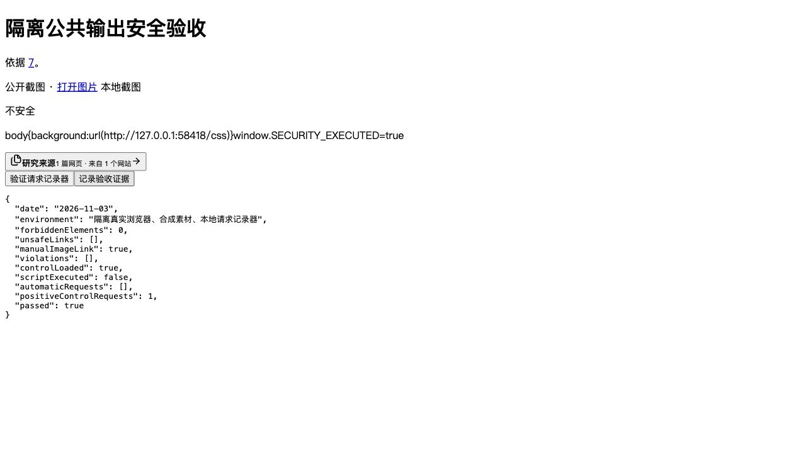

# 公共正文、来源链接与浏览器自动请求边界验收

日期：2026-11-04。范围为 BsAgent 本地实现和验收；沿用用户确认的“正文完整接收并检查后展示”，宿主任务进度事件仍可继续。未提交、部署或迁移，未修改独立 RAG 工程。

## 当前行为

| 边界 | 处理方式 |
| --- | --- |
| 模型检查后的引用插入 | 来源 URL 在插入 Markdown 前重新检查；带已知凭证的链接整体拒绝，不改成星号后继续使用 |
| 来源目录、补齐字段和卡片 | 完整检查标题/摘要/日期后截断；来源集合共用总预算，保留原始来源编号，不修改源对象 |
| 最终回答、公开进度、历史响应 | 共享凭证策略生成安全副本；不改角色、调用 ID、审批或真实执行状态；检查故障使用固定扣留内容 |
| 历史搜索摘要 | 原始正文、HTML 实体解码和 Markdown 清理后的正文再次检查，再生成截断摘要 |
| 可点击 URL | 限有效公开 HTTP(S)，拒绝 userinfo、已知凭证参数、控制字符、非法端口、已知私网/本地数值地址和本地域名；IDNA 后处理尾点，有限解码检查 |
| 普通正文/工具出入站中的 URL | 共享内核同样覆盖 `auth/key/signature/cookie/passwd`、query/hash、hash 路由及已知参数赋值形式；普通业务 JSON 的 `key/auth` 不自动成为敏感字段 |
| 两个搜索 provider 错误 | HTTP/超时/无效 JSON/过深 JSON 返回固定错误；保留状态和重试语义，在捕获块外抛出，不携带原传输异常链 |
| 浏览器 Markdown | 原始 HTML 不渲染；图片显示替代文字和安全地址的主动打开链接；来源 favicon 使用本地 SVG；危险 URL 不产生可操作链接 |

独立适配位于 `backend/app/security/public_output.py`、`frontend/src/security/public-url.ts`。共享凭证内核语义由 v3 升至 **v4**，配置摘要之外的规则变化也反映在元数据版本；旧缓存/摘要仍通过各自读取适配重新检查。公共输出是展示副本保护，不能替代外发前拒绝或可信身份授权。

## 测试与复核

- 服务端关联集合 **104 个文件，1922 passed、6 skipped**：[日志](2026-11-04-public-output-tests.log)、[JUnit](2026-11-04-public-output-tests.xml)、[清单](2026-11-04-public-output-test-files.txt)。6 项跳过为 5 项缺少真实 PostgreSQL 地址的迁移测试及 1 项未启用的真实 DeepSeek 压缩质量评测，不计通过。
- 公共输出专项 **92 passed**：[日志](2026-11-04-public-output-unit-tests.log)、[JUnit](2026-11-04-public-output-unit-tests.xml)。包含前后端共享的 54 个 URL 契约、长来源/总预算、检查故障、历史实体解码、两种搜索协议错误和内联凭证 URL；专项已包含在服务端关联集合内，不相加。
- 前端 **23 个文件、228 passed**：[日志](2026-11-04-public-output-frontend.log)、[JUnit](2026-11-04-public-output-frontend.xml)。前端构建通过，见 [构建日志](2026-11-04-public-output-build.log)；现有循环 chunk、体积、第三方注释和 npm 配置警告仍保留，不宣称零警告。
- 独立只读复核发现并修复 Unicode 尾点本地域名、URL 附加凭证参数、前端 JSON Unicode 敏感键、历史摘要实体解码顺序，以及共享内核 hash/colon 形式遗漏。最终专项与关联 **123 passed**，所审范围未发现剩余 P1/P2；不等于所有安全项完成。
- 新安全文件和本批选取的共享内核、引用/来源、进度、搜索客户端与专项测试 Ruff 通过；`graph/runtime.py` 通过。`api/sessions.py` 的 32 条 B008 与 HEAD 相同，没有新增；不宣称全工程静态检查全绿。`git diff --check` 和本批文档链接检查通过。

重要负例均先观察失败再修复。内联 URL 的 colon 测试使用不含敏感词的独立 canary，避免将测试值本身误识别成敏感字段导致假通过。普通财报查询、hash 路由、业务 JSON、来源编号、原对象及真实成功/完成状态都有正向对照。

服务端复跑：

```sh
xargs .venv/bin/python -m pytest -q --tb=short < docs/security/reports/2026-11-04-public-output-test-files.txt
```

前端复跑：在 `frontend` 执行 `npm test` 和 `npm run build`。

独立复核的最终 123 项复跑命令：

```sh
PYTHONDONTWRITEBYTECODE=1 PYTHONPATH=backend .venv/bin/python -m pytest -p no:cacheprovider backend/app/tests/unit/test_public_output_security.py backend/app/tests/unit/test_tool_outbound_policy.py backend/app/tests/unit/test_search_outbound_credentials.py backend/app/tests/unit/test_tool_redaction.py -q
```

## 真实浏览器证据

隔离页直接使用真实 React Markdown/来源组件，只有合成素材、本地资源请求记录器和证据接口，不加载业务 App、不访问真实业务 API/数据库。核对了引用卡片、来源面板、键盘打开/Escape 焦点恢复；危险 HTML 未执行，没有自动图片/favicon 请求。

[结构化证据](2026-11-04-public-browser.json)：`forbiddenElements=0`、`unsafeLinks=[]`、`violations=[]`、`automaticRequests=[]`、`positiveControlRequests=1`、`controlLoaded=true`、`scriptExecuted=false`、`passed=true`。主动加载本地对照图片证明记录器有效；CSP 违规也计失败，不能靠 CSP 掩盖渲染器发出的请求。没有点击外部图片/链接，没有访问真实敏感素材。



页面 fixture 版本为 2026-11-03，实际验收发生在 2026-11-04；保留 [原始报告](2026-11-03-public-browser.json)，日期校正副本附原始文件引用和记录时间。可复跑脚本为 `frontend/scripts/security-browser-fixture.mjs`：本地运行后打开输出的隔离页，操作来源、键盘交互及正向对照，再记录证据。该脚本需允许监听回环端口；当前临时服务和浏览器页已关闭。

## 未覆盖与后续 TODO

1. **业务分类与接收方用途**仍未定义。URL 的 `key/auth/signature` 采取保守拒绝，业务若使用同名公开参数会被阻断；普通文字/JSON 同名字段不自动受此 URL 规则影响。未知业务秘密、任意改写/编码和多轮洗白不能由通用凭证规则识别。
2. **旧持久化 SSE 的任意跨帧重建**仍待专项验收；不能将当前完整模型缓冲和相关历史 DTO 检查推定为所有历史流已经安全。历史数据库、对象和 checkpoint 原文未批量清理。
3. **DNS 解析、重定向和整体网络预算**不在公开链接格式检查范围内。主动打开链接会访问目标站点；此项未实现通用 Fetch/浏览器沙箱，也不证明所有 HTTP 服务的响应大小、并发和取消边界已受控。
4. **隐藏客户端、独立 handler/exporter、metrics label、其它持久化出口**仍须单独验证。当前内核/公共适配与两个搜索客户端通过，不能推定私有绕过路径自动受控。
5. **真实模型提示注入、图片像素分类/可信 OCR、RAG 下游服务身份与文档 ACL、真实部署**继续待验收；有限模式和 URL 校验不代表提示注入已被全面防住。

对应 SEC-05/07/10/12 总项保持未勾选，后续依照 [安全 TODO](../TODO.md) 逐项补证。
