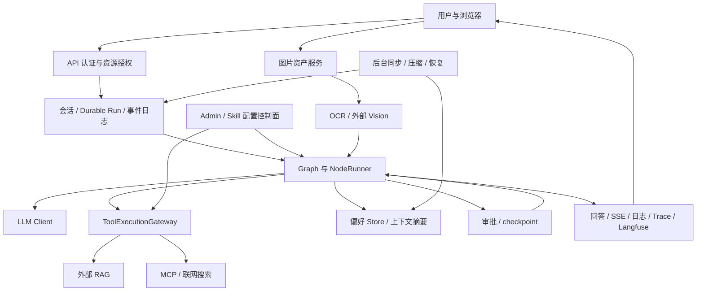

# 当前投研链路威胁模型与安全接入点

初始日期：2026-11-02；当前源码复核：2026-11-08。范围依据：[范围与验收约定](README.md)。

本文是基于当前工作区源码的静态调用路径清单，不是已执行的渗透测试报告。所有风险均需按可达性、配置和实际行为验证；源码存在检查不等于检查已经覆盖全部路径。对应的执行任务与攻击样例见 [红队测试 Prompt](red-team-prompt.md)。

[首轮本地验证报告](reports/2026-11-02-red-team-report.md)保留历史行为。下表已按后续实现刷新，不能把首轮“未鉴权”等描述当成当前源码状态。各批动态证据见 [验收索引](README.md)，实际生产配置和外部 RAG ACL 仍待补证。SEC-01 的完成仅表示静态清单已覆盖，不表示下列控制全部验收通过。

## 1. 资产、攻击者与假设

| 资产 | 安全目标 |
| --- | --- |
| 用户及租户身份、会话、消息、运行与 SSE 事件 | 未获授权者不能读取、修改、停止或恢复他人的资源 |
| 内部知识库与图片、OCR/Vision 结果 | 检索与分析受资源授权约束，数据仅进入允许的服务和输出 |
| MCP URL、模型 Key、数据库及对象存储凭证 | 由服务端设施管理，不进入模型可见上下文或非授权出口 |
| 工具目录、Skill、权限、审批及 checkpoint | 外部内容和模型建议不能改变授权或伪造可信控制状态 |
| 长期偏好、上下文摘要与投研证据 | 不能混淆用户授权与外部陈述；来源、限制和不确定性不能被洗掉 |
| 模型、工具、后台任务额度与副作用回执 | 防止无界调用、重复派发和未知写入被当作未执行 |
| 回答、审计、日志、Trace、Langfuse 内容 | 防止泄密、伪造审计与不安全渲染，保留可核实的执行证据 |

攻击者包括：恶意普通用户、其他用户或租户、控制网页/研报/OCR 文本的外部内容提供者、控制 MCP 返回值或工具描述的服务方，以及取得普通账号后试图访问控制面的主体。

部署管理员、数据库管理员、认证服务和执行进程属于高权限信任域，但仍应验证其配置边界。取得任意服务端代码执行权后的完整进程隔离不由本期进程内模块保证；对应新增执行能力要求保留在未来 TODO。

测试必须区分攻击者实际可控输入与测试注入点。直接改写 State、审批表或数据库只能证明内部不变量，不能自动证明普通用户能够触发同样行为。

## 2. 数据流与信任边界

边界依次为：用户到服务端身份域、外部数据到模型上下文、模型建议到可执行调用、用户资源到服务凭证、业务状态到恢复控制状态、前台到后台身份域、内部数据到外部服务和浏览器输出。授权必须在资源访问前落实，不能靠最终回答补救。

## 3. 现有机制与接入位置

每行列出受保护资产、源码入口、可信身份来源与跨越的信任边界，以及当前控制或明确缺口。攻击者包括用户输入、模型建议和不可信外部服务；后台行还需考虑队列与持久化状态的篡改。服务端数据库/队列并非普通用户可写，直接修改它们的测试不能推断外部可达。

| 路径、接入位置与资产 | 可信身份来源与信任边界 | 当前控制及尚未覆盖范围 |
| --- | --- | --- |
| 认证与权限：[dependencies](../../backend/app/security/dependencies.py)、[JWT](../../backend/app/security/jwt_provider.py)、[directory](../../backend/app/security/directory.py)；用户、租户、scope | JWT 签名、issuer/audience/exp 校验后映射当前应用目录；请求体和普通 Header 不能赋予生产身份 | 生产要求 JWT/principal；真实目录停用、成员和权限检查；local mock 显式例外。真实 IdP 配置、主动撤销/JWKS 变更同步仍待验收 |
| 会话/运行 API：[sessions](../../backend/app/api/sessions.py)、[runs](../../backend/app/api/runs.py)；消息、附件引用、运行/停止状态 | Principal 与数据库 tenant/user/session 归属相互核对；资源 ID、游标不是授权凭据 | 当前资源隔离和任务权限上限已接入；实际部署、跨版本及所有身份矩阵仍需独立验收 |
| SSE/AG-UI/持久化重放：[stream_authorization](../../backend/app/security/stream_authorization.py)、[protocol_replay](../../backend/app/security/protocol_replay.py)、[ag_ui](../../backend/app/api/ag_ui.py)；正文和事件 | 保留原请求 Principal/exp，推进和发布前重新读目录及资源；数据库旧正文属于不可信展示输入 | 正文完整检查后发布，跨片段/分页/游标重建；未封口正文不经历史旁路展示；撤权停止订阅。已发字节不可撤回，慢客户端/查询/连接成本仍缺全局预算 |
| Graph/后台运行：[runtime](../../backend/app/graph/runtime.py)、[node_runner](../../backend/app/harness/node_runner.py)、[dispatcher](../../backend/app/conversations/dispatcher.py)、[run_authorization](../../backend/app/security/run_authorization.py)；控制状态/checkpoint | 首次验证请求建立独立持久化授权记录；worker 从服务端 payload 还原并 refresh_run；Graph State 自报身份不构成授权 | 当前权限与首次上限取交集，校验 handle/run/session；新建run冻结持久化预算，执行快照/Graph/节点/受管派发与响应共用；缺账本不恢复。未接入客户端、独立job、费用/全局并发仍有缺口 |
| 模型输入：[factory](../../backend/app/llm/factory.py)、[model_input](../../backend/app/security/model_input.py)、[input_guard](../../backend/app/llm/input_guard.py)；历史、摘要、工具消息、业务数据 | 身份来自受信调用上下文；历史/证据/摘要仅为数据，不能成为新的授权 | 当前 sync/async/stream/原生绑定入口使用安全副本与凭证底线；不改审批指纹。业务类别未定义、来源追踪和隐藏客户端待补 |
| 模型输出/SDK 回调：[model_output](../../backend/app/security/model_output.py)、[output_callbacks](../../backend/app/llm/output_callbacks.py)、[deepseek](../../backend/app/llm/deepseek.py)；正文/传输错误 | 模型与 SDK 内容均不可信；发布权限仍取请求/任务上下文 | 完整接收后检查，受管回调和固定错误不提前外发正文；不能证明模型抵抗所有注入。直接 HTTP 已接入实体/解压/行预算与异步期限；当前 ChatOpenAI SDK 原始读取也已接入预算；其它自建SDK、同步阻塞及未知 callback/handler 继续待补 |
| 工具/原生调用：[execution_gateway](../../backend/app/tools/execution_gateway.py)、[native_calls](../../backend/app/tools/native_calls.py)、[tool_agent](../../backend/app/graph/nodes/tool_agent.py)；调用参数、目录、回执 | host 生成 call ID，绑定可信 ToolContext、当前任务权限、注册目录/Plan/Skill 及参数指纹；模型只提议调用 | 派发前刷新授权，schema/审批/风险与出站检查、成功失败异常共享内容处理；直接绕过适配层的新客户端需要接入；目录/替代工具组合继续验收 |
| HTTP RAG：[rag_search](../../backend/app/tools/rag_search.py)、[调用方约束](rag-caller-boundary.md)；检索资料与服务连接 | tenant/user 由 host 上下文冻结；模型 filters 不赋予身份。当前 tracing Header 不能证明向上游委派身份 | BsAgent 本地身份约束和公共入出站保护已接入；外部 localhost:8011 服务身份、用户委派、文档 ACL 未验收。公开 OpenAPI 无 securitySchemes 不能证明无中间件鉴权；未改外部工程 |
| 搜索：[deepseek](../../backend/app/search/deepseek.py)、[deepseek_api](../../backend/app/search/deepseek_api.py)、[web_search](../../backend/app/tools/web_search.py)；查询、引用/URL | 工具权限来自当前 Principal/任务上限；最终 wire payload 按服务端策略复查 | 通用凭证外发拒绝、固定错误链、有限 web_search 预算；普通业务敏感信息、DNS/重定向/接收方准入、直接 HTTP 单响应实体/解压及异步期限已接入，总run字节/期限仍缺口 |
| MCP/Skill 供应链：[market_data_config](../../backend/app/tools/market_data_config.py)、[mcp_gateway](../../backend/app/tools/mcp_gateway.py)、[skills/factory](../../backend/app/skills/factory.py)；连接凭证、工具描述与发现绑定 | 连接取受控 Admin 服务接口，运行权限另行检查；工具描述/发现结果不可自授权限 | 已有版本/风险/权限与绑定检查；Tushare 只读语义不能推广未知 Server。当前MCP官方SDK已接入实体/解压/行/目录累计预算，不跟随HTTP跳转；真实目标准入、DNS、第三方供应链、变更漂移仍待验收 |
| Admin 用户/服务：[security](../../admin/backend/app/security.py)、[main](../../admin/backend/app/main.py)、[主服务适配](../../backend/app/security/admin_service_auth.py)；配置/完整连接 | 用户与服务分离 JWT audience、当前 Admin grant；OIDC 认证复用，授权由目录决定 | 当前源码已要求准入，服务只读接口与用户管理分离；local/test mock 例外。全局配置权限不是租户级目录；实际网络、密钥轮换和生产授权仍待验收 |
| 图片上传/读取/派发：[assets API](../../backend/app/api/assets.py)、[asset_authorization](../../backend/app/security/asset_authorization.py)、[service](../../backend/app/assets/service.py)；原图/对象存储 | 当前 Principal、同租户 owner 或明确操作 :any；后台使用持久化身份并查当前目录/期限 | 大小/像素/格式约束及用户归属；本批上传限额应用每 app 配置。生产对象存储、完整原图类别和未知多模态秘密仍待验收 |
| OCR/Vision：[processor](../../backend/app/vision/processor.py)、[image_content](../../backend/app/security/image_content.py)、[context](../../backend/app/vision/context.py)；像素、文本、缓存/artifact | 资产绑定前述可信身份；外部 OCR/Vision 输出与旧缓存仍为不可信内容 | 文本落盘/缓存/API/上下文共用检查，识别凭证/有限信号后不继续 Vision；首个 OCR 像素外发及 OCR 失败 fallback 的秘密识别无保证。并发限制仅局部实例 |
| 长期记忆：[candidates](../../backend/app/memory/candidates.py)、[记忆绑定](../../backend/app/security/memory_candidate.py)、[preferences](../../backend/app/memory/preferences.py)、[synchronizer](../../backend/app/memory/synchronizer.py)；偏好/审批/Store | 前台tenant/user来自可信调用上下文；新ID绑定精确主体/审批内容，既有更新锁后复查归属及终态字段；后台按记录自身命名空间写Store，无新用户JWT | 候选、读写/补偿有凭证底线；最终put复查声明及现有敏感规则的批准要求，不批准不反复补偿。后台当前权限、完整来源、同键版本/新意图、历史污染与真实PG仍待验收，namespace和当前规则不等于全部授权 |
| 摘要/后台压缩：[service](../../backend/app/context_compaction/service.py)、[summarizer](../../backend/app/context_compaction/summarizer.py)、[dispatcher](../../backend/app/context_compaction/dispatcher.py)、[tasks](../../backend/app/context_compaction/tasks.py)；历史/摘要/版本 | 请求侧派发服务端 tenant/user/session_key；worker 信任队列参数并用资源版本/租约读写，没有独立用户 JWT | 来源/旧摘要/repair/active 验证共享内容检查、结构/token 约束；后台身份委派和当前权限、摘要来源追踪、多轮污染仍缺独立证据 |
| 审批/恢复：[approvals API](../../backend/app/api/approvals.py)、[approval_gate](../../backend/app/graph/nodes/approval_gate.py)、[state](../../backend/app/graph/state.py)；审批快照、调用/参数、checkpoint | 当前审批者Principal与原任务独立授权上限、资源、调用/参数指纹复核；展示文本不授予额外范围 | 当前目录与恢复复核，HTTP decision复用agent限额；AG-UI外层计费一次。记忆落库冲突固定拒绝并释放任务；完整并发/跨版本矩阵、历史批准追溯及新意图治理仍待验收 |
| 停止/执行回执/恢复：[execution](../../backend/app/conversations/execution.py)、[durable](../../backend/app/conversations/durable.py)、[recovery](../../backend/app/conversations/recovery.py)；已派发/未知副作用 | API 请求者先做资源权限；执行 owner/lease/generation、数据库 receipts 与独立 run 授权记录属于控制面 | 取消检查、回执围栏和未知结果阻止盲重放；在途远端操作不因订阅关闭而撤回，不能硬杀后假称未发生。完整恢复与真实多进程继续待验收 |
| 观测/持久化：[observation](../../backend/app/security/observation.py)、[observability](../../backend/app/operations/observability.py)、[persistence](../../backend/app/harness/persistence.py)、[traces API](../../backend/app/api/traces.py)；日志/Trace/OTLP/Langfuse/原始 DB | 出口配置与 SDK/handler 由服务端管理；Trace API 使用当前 Principal、租户及明确特殊权限 | 受管内容出口有共享保护，保留业务/控制字段；原始 DB/checkpoint 未全量改写，历史原文清理、独立 handler/exporter/metrics label 与独立安全审计仍未完成 |
| 浏览器展示：[public_output](../../backend/app/security/public_output.py)、[Markdown](../../frontend/src/components/research/research-markdown.tsx)、[URL 策略](../../frontend/src/security/public-url.ts)；正文/来源/自动请求 | 来源卡片与历史内容均不可信；登录上下文不等于允许任意远端资源请求 | 完整文本检查后 DTO 裁剪、URL 检查、关闭原始 HTML/远程 Markdown 图片、favicon 本地化；真实浏览器已有隔离证据。用户主动导航、未知组件/协议继续验收 |
| 入口预算/健康检查：[rate_limit](../../backend/app/operations/rate_limit.py)、[health API](../../backend/app/api/health.py)、[readiness](../../backend/app/operations/health.py)；可用性、服务信息、调用额度 | 限额 key 取 Principal tenant/user 摘要；必需 backend/阈值取实际 app 受信配置，业务 JSON 不能关闭 | 生产 Redis fail-closed；缺服务/畸形响应固定503；公共健康仅状态，不返回依赖异常。当前run基础资源已有独立冻结账本；GET订阅连接/全局并发及费用等仍缺统一限额；详见 [预算基线](runtime-budget-baseline.md) |

外部 RAG 的服务端 ACL、反向代理、身份网关与生产网络实际配置不在此次已验收范围内。数据库、队列、对象存储和 IdP 的真实部署证据仍必需。

## 4. 威胁清单与红队映射

STRIDE：S＝身份伪造，T＝篡改，R＝抵赖，I＝信息泄露，D＝拒绝服务，E＝权限提升。优先级表示验证顺序，不是已确认漏洞的严重等级。

| 威胁 | 类别 / 优先级 | 攻击路径与应保持的不变量 | 红队案例 | TODO |
| --- | --- | --- | --- | --- |
| TH-01 身份与对象越权 | S/I/E · P0 | 请求体、Header、资源 ID 或流游标不能替代可信主体授权 | RT-01、13、14 | SEC-03 |
| TH-02 RAG 身份断链 | S/I/E · P0 | 共享服务凭证或 filters 不得让检索跨越文档 ACL | RT-04、15 | SEC-03、05 |
| TH-03 控制面被普通主体访问 | S/I/T/E · P0 | 非授权者不能读完整连接或修改工具/Skill 配置 | RT-25、28、31 | SEC-11 |
| TH-04 证据指令化与目标劫持 | T/E · P0 | 搜索、OCR、工具结果及错误文本不能生成新的权限或改变可信控制状态 | RT-03～07、10、12 | SEC-02、07 |
| TH-05 数据与凭证外泄 | I · P0 | 内部数据及合成凭证不能进入禁止的模型、搜索、链接、日志或观测出口 | RT-02、04、10、23、24、30 | SEC-05、10 |
| TH-06 工具权限或参数绕过 | T/E · P0 | Plan/Skill、schema、服务端参数和风险等级不能被模型绕过 | RT-06、16、28 | SEC-04 |
| TH-07 审批授权扩大或重放 | S/T/E · P0 | 审批只适用原调用、参数和身份；恢复仍受当前权限约束 | RT-12、17～20 | SEC-04、06 |
| TH-08 未知副作用与重复派发 | T/D · P0 | 错误、停止、恢复和重试不能把不确定写入变成可盲重试的未执行状态 | RT-21、22 | SEC-06 |
| TH-09 长期记忆与摘要污染 | T/E · P1 | 外部陈述不能变为用户偏好或审批依据，跨会话不能扩大权限 | RT-08～10 | SEC-08 |
| TH-10 不安全输出与伪造证据 | T/I · P1 | 回答及引用不执行脚本或自动外传数据；未知来源不能伪造成已验证事实 | RT-11、24 | SEC-07、12 |
| TH-11 运行失控与资产滥用 | D · P1 | 预算、并发、文件尺寸和像素约束对真实调用生效 | RT-27、29 | SEC-09 |
| TH-12 安全检查及审计失效 | R/I/E · P1 | 强制检查故障不放行；普通 Trace 未采样不等于可以丢弃应有安全证据 | RT-26、30 | SEC-10 |

每个攻击案例都需要授权、数据、语义相近的正常对照，统一要求见 RT-32。新增任意代码执行、文件修改、交易等能力继续遵循 [未来 TODO](TODO.md)。

## 5. 优先补证与实施顺序

1. 静态路径清单已覆盖 SEC-01；按 [TODO](TODO.md)保留其它总项，不用已存在的局部实现替代整体动态验收。
2. 当前受管模型/工具/HTTP、请求正文、实体/解压信用及期限已接入持久化run账本，恢复不补发、越额停止、回执保留；继续补token/费用、事件/存储、独立job、全局并发和生产多进程验收，见 [预算基线](runtime-budget-baseline.md)。
3. 补齐后台记忆/压缩当前权限与来源、独立安全审计、规则版本和失败策略；统一公共适配契约，记录无法无侵入覆盖的路径。
4. 补充 RAG 下游服务认证/文档 ACL、真实 IdP/生产网络与数据库证据；保留受信委派和服务主体边界。
5. 在确定性授权和数据出口案例之外，执行正常对照的真实多轮/多模态模型注入评估，分别报告硬边界、误报、漏报与延迟。

## 6. 方法参考

攻击面分类和测试设计参考 [OWASP 提示注入防护说明](https://cheatsheetseries.owasp.org/cheatsheets/LLM_Prompt_Injection_Prevention_Cheat_Sheet.html)中的间接、多轮、多模态注入及结果评估思路；MCP 身份与连接边界参考 [MCP 官方安全实践](https://modelcontextprotocol.io/docs/tutorials/security/security_best_practices)。项目判断仍需本仓库与实际环境证据。
