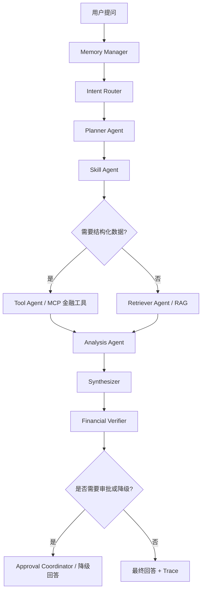

# A 股公司研究 Agent MVP 设计

日期：2026-07-03
状态：待用户评审
范围：面向投研分析师的 A 股公司研究 Agent。本文只定义产品与技术设计，不包含前端页面实现和具体代码实现计划。

## 1. 产品定位

第一版定位为面向投研分析师的 A 股公司研究 Copilot。

它不是投资建议机器人、荐股机器人或自动交易系统，而是帮助分析师更快完成公司资料整理、财报解读、公告分析、风险识别、研究草稿生成和证据链追踪。

核心原则：

- 辅助研究，不替代分析师判断。
- 可以生成观点草稿，但必须区分事实、推断和待验证问题。
- 所有关键结论应可追溯到 RAG 证据、结构化财经 API 或工具结果。
- 禁止直接给出买卖建议、收益承诺、无依据目标价和交易指令。
- 默认中文输出，并使用 BsAgent 产品口径，不暴露底层 LLM provider、MCP 内部实现或工具内部名称。

## 2. 目标用户和高频任务

目标用户是 A 股二级市场投研分析师，包括买方研究员、卖方研究员、行业研究员和投资经理助理。

MVP 优先支持三类任务：

1. 公司速览
   输入公司简称、股票代码或自然语言问题，输出主营业务、行业位置、关键财务表现、近期事件、风险点和待验证问题。

2. 财报解读
   输入公司和报告期，输出收入、利润、毛利率、现金流、负债、费用、研发、异常变化和可能原因。

3. 风险扫描
   输入公司和时间范围，输出经营风险、财务风险、监管风险、资本市场事件和后续关注点。

暂缓支持：

- 自动估值模型和目标价生成。
- 买卖评级。
- 组合优化。
- 自动交易。
- 深度行业图谱。
- 完整研报自动成稿。

## 3. 数据策略

MVP 采用 RAG 与结构化财经 API 分工协作。

RAG 负责非结构化证据检索：

- 年报、半年报、季报。
- 临时公告和重大事项公告。
- 交易所问询函和回复。
- 研报。
- 新闻。
- 行业政策。
- 内部研究资料。

财经 API 负责结构化数据：

- 公司基础信息。
- 行情快照。
- 财务指标。
- 估值指标。
- 行业分类。
- 同业公司列表。
- 风险事件元数据。

设计上抽象统一 `MarketDataProvider`，Agent 不直接依赖 AkShare、Tushare、Wind、Choice 或 iFinD。MVP 可以先实现 AkShare 或 Tushare adapter，后续替换数据源时只改 provider 和 MCP tool adapter。

```text
MarketDataProvider
- resolve_company(query)
- get_company_profile(symbol)
- get_market_snapshot(symbol)
- get_financial_metrics(symbol, period)
- search_announcements(symbol, date_range)
- get_risk_events(symbol, date_range)
```

结构化数字优先来自财经 API。RAG 文档中的数字可作为文本证据辅助，但不应作为唯一结构化指标来源。

## 4. 高层链路



现有 Agent 图可以保持主干不变，金融能力通过 intent 配置、Skill、Tool、Verifier 规则和 Synthesizer 输出契约扩展。

## 5. Intent 设计

MVP 建议配置这些业务意图：

```text
company_research.company_snapshot
company_research.financial_report_analysis
company_research.risk_scan
company_research.announcement_interpretation
company_research.peer_compare_later
```

`peer_compare_later` 第一版可以识别，但降级提示“同业对比能力正在接入中”，避免 Planner 误规划未实现链路。

Intent Router 输出需要包含：

- `intent`: `knowledge_qa`、`tool_action`、`task_workflow` 或 `unsupported`。
- `domain`: `a_share_equity_research`。
- `sub_intent`: 公司速览、财报解读、风险扫描等业务操作意图。
- `candidate_skill`: 对应 Skill 名称。
- `candidate_tool`: 仅在直接工具操作时使用。
- `risk_level`: 金融合规风险等级。
- `needs_clarification`: 是否缺少公司、报告期、时间范围等必要信息。
- `reason_codes`: 命中规则、业务配置或 LLM 分类的原因。

## 6. Skill 设计

MVP 只实现三个核心 Skill。

### company_snapshot

用途：公司速览。

典型问题：

- “分析一下贵州茅台”
- “帮我看一下 600519”
- “宁德时代现在基本面怎么样”

输入：

- 公司名、简称或股票代码。
- 可选时间范围。
- 可选关注点，例如“业务”“风险”“近期公告”。

规划动作：

- 调用 `stock.resolve_company` 标准化证券代码。
- 调用 `stock.company_profile` 获取公司基础信息。
- 调用 `stock.market_snapshot` 获取行情和估值快照。
- 调用 RAG 检索近期公告、研报、新闻或内部资料。
- 输出公司概览、核心业务、关键财务表现、近期事件、风险点和待验证问题。

### financial_report_analysis

用途：财报解读。

典型问题：

- “分析宁德时代 2024 年报”
- “看看万华化学 2025Q1 财报有什么变化”
- “这家公司利润增长质量怎么样”

输入：

- 公司。
- 报告期。
- 可选指标范围。

规划动作：

- 调用 `stock.resolve_company`。
- 调用 `stock.financial_metrics` 获取结构化财务指标。
- 调用 RAG 检索对应年报、季报、业绩说明会或公告正文。
- 分析收入、利润、盈利质量、现金流、负债、费用、研发和异常点。
- 输出必须区分“指标变化”“文本解释”“推断原因”和“待验证问题”。

### risk_scan

用途：风险扫描。

典型问题：

- “看看隆基绿能最近有什么风险”
- “这家公司有没有监管或诉讼风险”
- “过去半年有没有减持、问询函或处罚”

输入：

- 公司。
- 时间范围，默认最近 6 个月。
- 可选风险类别。

规划动作：

- 调用 `stock.resolve_company`。
- 调用 `stock.risk_events` 获取结构化风险事件。
- 调用 `stock.announcement_search` 获取公告元数据。
- 调用 RAG 检索问询函、处罚、诉讼、减持、质押和重大事项公告。
- 输出风险总览、分类风险、风险等级、证据来源和后续关注点。

## 7. MCP Tool 设计

所有外部财经数据调用都通过 Tool Agent 执行。Agent 不直接访问财经 API、数据库或外部服务。

第一版 MCP tools：

```text
stock.resolve_company
stock.company_profile
stock.market_snapshot
stock.financial_metrics
stock.announcement_search
stock.risk_events
```

工具职责：

- `stock.resolve_company`：把公司名、简称或代码标准化为证券代码，例如 `600519.SH`。
- `stock.company_profile`：返回公司名称、上市板块、行业、主营业务、注册地址、实控人等。
- `stock.market_snapshot`：返回价格、市值、涨跌幅、PE、PB、成交额等。
- `stock.financial_metrics`：返回收入、归母净利、扣非净利、毛利率、ROE、经营现金流、资产负债率等。
- `stock.announcement_search`：返回公告标题、日期、类型、链接或 RAG 文档 ID。
- `stock.risk_events`：返回问询函、处罚、诉讼、减持、质押、业绩预告异常等事件摘要。

工具结果必须结构化，至少包含：

- `source_provider`
- `as_of_date`
- `symbol`
- `data`
- `warnings`
- `trace_ref`

如果数据供应商返回空数据或延迟数据，Tool Result 必须明确标注，不允许 Synthesizer 把缺失数据包装成确定结论。

## 8. RAG 职责

RAG 继续作为 retrieval-only 服务，只负责检索，不负责长期知识写入，也不负责业务决策。

Retriever Agent 在金融场景下需要做：

- 根据公司标准代码、公司简称、公告类型和报告期生成检索 query。
- 对公告、年报、问询函、研报和新闻进行多路检索。
- 对同一事实的多个来源进行去重。
- 把证据打包为 `EvidencePackage`。
- 标记证据覆盖度：`sufficient`、`partial` 或 `none`。

MVP 不要求 RAG 做复杂金融推理，推理留给 Analysis Agent 和 Verifier。

## 9. 输出契约

最终回答默认纯文本或轻量 Markdown，但短答案和工具结果不使用加粗、标题装饰或内部工具名称。

公司速览输出：

```text
公司概览
核心业务
关键财务表现
近期重要事件
主要风险点
待进一步验证的问题
资料来源
免责声明
```

财报解读输出：

```text
摘要结论
收入与利润变化
盈利质量
现金流质量
资产负债情况
费用与研发
异常点
风险提示
引用依据
免责声明
```

风险扫描输出：

```text
风险总览
经营风险
财务风险
监管/合规风险
资本市场事件
风险等级
证据来源
后续关注点
免责声明
```

免责声明 MVP 固定为：

```text
以上内容仅用于投研辅助分析，不构成投资建议、买卖建议或收益承诺。
```

## 10. Financial Verifier

金融场景需要在现有 Verifier 上增加金融专属规则。

必须拦截或降级：

- “建议买入”“建议卖出”“满仓”“梭哈”“稳赚”等交易指令或收益承诺。
- 没有证据或工具结果支撑的目标价。
- 没有来源的关键财务数字。
- 把传闻、新闻或研报观点当成已确认事实。
- 把管理层展望当成确定结果。
- 未说明不确定性的风险结论。
- 未附免责声明的投研输出。

Verifier 输出建议包含：

- `verdict`: `pass`、`revise`、`reject` 或 `needs_approval`。
- `finance_policy_violations`: 金融合规问题列表。
- `unsupported_claims`: 未支撑结论列表。
- `numeric_source_issues`: 数字来源问题列表。
- `required_action`: `respond`、`revise_answer`、`retrieve_more` 或 `approval_required`。

## 11. 记忆策略

MVP 不把公司知识写入长期记忆。公司知识属于长期 knowledge，应由外部 RAG 索引服务维护。

Agent 只管理长期经验和用户偏好，例如：

- 用户偏好中文输出。
- 用户偏好关注现金流、ROE、风险事件或行业对比。
- 用户是偏成长、价值、周期、红利或量化视角的研究风格。
- 用户常看的市场或行业。

这些经验记忆必须走 memory candidate 和审批策略，避免模型自动污染用户画像。

## 12. 可观测性和 Trace

投研分析师需要看到结论是如何来的，因此 trace 是产品能力的一部分，不只是工程调试。

每次 run 至少展示：

- Intent Router 识别出的公司研究意图。
- Planner 拆出的步骤。
- Skill 选择结果。
- Tool Agent 调用过哪些金融工具。
- RAG 检索了哪些资料。
- Analysis Agent 抽取了哪些发现。
- Verifier 发现了哪些风险或通过了哪些检查。
- 最终回答引用了哪些证据和工具结果。

用户界面上可以把 trace 分为“简洁解释”和“工程调试详情”两层。普通分析师默认看到简洁解释；开发和运维可以查看完整 artifact。

## 13. 错误和降级策略

公司识别失败：

- 请求用户补充股票代码、交易所或公司全称。

财经 API 不可用：

- 降级为仅基于 RAG 的文本分析，并明确说明结构化行情或财务指标暂不可用。

RAG 无证据：

- 不能生成确定结论，只能说明未检索到足够证据，并建议补充资料。

财务指标与文档证据冲突：

- 标记冲突，分别列出 API 数据和文档说法，不强行合并。

高风险表达：

- Verifier 要求改写、降级或进入人工审批。

工具超时：

- Tool Agent 记录失败原因和 trace，Planner 可选择重试、换数据源或降级。

## 14. 测试和评测

MVP 至少需要这些测试：

- Intent golden set：公司速览、财报解读、风险扫描、公告解读、越界买卖建议。
- Tool contract tests：每个 MCP tool 的输入输出 schema、空数据、超时、供应商错误。
- RAG integration tests：年报、公告、研报、新闻的检索结果映射为 `EvidencePackage`。
- Graph integration tests：三条主链路从用户问题跑到最终回答。
- Verifier tests：买卖建议、收益承诺、无依据目标价、无来源数字必须被拦截。
- Snapshot tests：输出格式稳定，不暴露 DeepSeek、MCP 内部工具名或无关 provider 信息。
- Live smoke tests：在显式环境变量开启时调用真实 RAG 和真实财经数据源。

评测集建议从 20 个 A 股公司问题开始，覆盖白酒、新能源、银行、医药、半导体、周期、地产链和消费。

## 15. MVP 交付顺序

建议顺序：

1. 定义 `MarketDataProvider` 接口和金融 Tool schema。
2. 搭建 MCP 金融工具服务，先接一个 provider adapter。
3. 配置 A 股公司研究 intent 和 sub_intent。
4. 实现 `company_snapshot` Skill。
5. 实现 `financial_report_analysis` Skill。
6. 实现 `risk_scan` Skill。
7. 强化 Financial Verifier。
8. 调整 Synthesizer 输出契约和免责声明。
9. 增加 trace 展示字段。
10. 建立 golden eval 和 live smoke。

第一版成功标准：

- 用户输入 A 股公司名或代码后，Agent 能识别公司并完成公司速览。
- 财报解读能同时使用结构化财务指标和 RAG 文档证据。
- 风险扫描能列出风险类型、证据来源和后续关注点。
- 所有关键结论有 trace、来源或工具结果。
- 不输出买卖建议、收益承诺和无依据目标价。

## 16. 非目标

MVP 明确不做：

- 投资组合优化。
- 自动交易或下单。
- 实时交易信号推送。
- 保证收益或收益预测承诺。
- 正式研报自动发布。
- 多市场全覆盖。
- 复杂估值模型和目标价自动生成。

