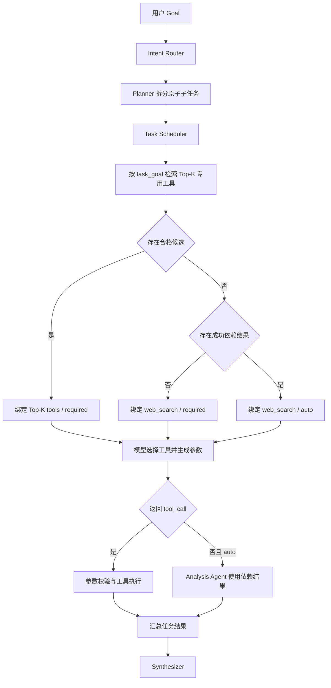

# 按子任务检索与原生工具绑定设计

## 背景

当前任务图在 Planner 之前使用完整 Goal 检索一次 Top-K 工具，随后由 Planner 同时完成任务拆分和 `tool_name` 选择。Tool Agent 接收已经确定的单个工具，只让模型生成调用参数。

该结构存在四个问题：

1. 完整 Goal 往往包含技术面、资金面、新闻情绪等多个维度，单次全局 Top-K 容易被同类工具占满。
2. Planner 同时承担任务分解和工具选择，必须理解所有候选工具的细节。
3. `web_search` 作为宽泛平台工具始终可见，容易在结构化数据工具之前被选择。
4. Planner 主动调用第二层 `search_tool` 后还要重新规划，增加延迟，也会掩盖第一次工具检索的质量问题。

本设计将任务规划和工具绑定拆开：Planner 只生成原子子任务；系统按每个子任务检索候选工具；Tool Agent 通过模型原生 Tool Calling，在候选工具中选择一个并同时生成参数。

## 目标

1. Planner 不再提前指定 `tool_name`，只描述任务目标和依赖关系。
2. 每个待执行子任务使用自身 `task_goal` 检索候选工具。
3. 将候选工具的完整 schema 放入 Chat Completions `tools` 参数，由模型选择工具并生成参数。
4. 存在合格专用工具时使用 `tool_choice="required"`。
5. 没有合格专用工具且缺少可用依赖证据时，降级到 `web_search` 并使用 `tool_choice="required"`。
6. 没有合格专用工具但已有依赖证据时，可将 `web_search` 作为可选补充并使用 `tool_choice="auto"`；模型不调用工具时进入分析。
7. 移除 Planner 可调用的第二层 `search_tool` 和对应重规划回路。
8. 参数错误在当前 Tool Agent 内定向修复，不触发整图重规划。
9. 全链路记录候选工具、选择结果、降级原因和重试次数，不记录凭证和敏感参数。

## 非目标

- 本次不重构 Skill 的发现和执行协议。
- 本次不新增投资策略或技术指标算法。
- 本次不改变 Tushare MCP 的工具 schema。
- 本次不让模型一次调用多个工具；需要多个数据源时由 Planner 拆成多个可并行子任务。
- 本次不保留第二层 `search_tool` 作为隐藏兜底。

## 总体链路



## Planner 契约

Planner 只负责拆分完成 Goal 所需的最少原子任务，并声明真实依赖。工具型任务和分析型任务不通过额外布尔字段预先分类。

计划示例：

```json
{
  "public_summary": "将分别核对量价趋势、资金变化和新闻情绪，再综合判断。",
  "tasks": [
    {
      "id": "price_trend",
      "task_goal": "获取银之杰近期日线价格和成交量并判断量价趋势",
      "depends_on": []
    },
    {
      "id": "capital_flow",
      "task_goal": "获取银之杰近期资金流向和融资变化",
      "depends_on": []
    },
    {
      "id": "news_sentiment",
      "task_goal": "获取银之杰近期公告、新闻和市场情绪",
      "depends_on": []
    },
    {
      "id": "final_judgment",
      "task_goal": "根据量价、资金和新闻结果综合判断风险收益状态",
      "depends_on": ["price_trend", "capital_flow", "news_sentiment"]
    }
  ]
}
```

为兼容现有 Skill，`skill_name` 暂时保留为可选字段。Planner 明确选择 Skill 时继续进入 Skill Agent；未选择 Skill 的任务进入按子任务工具检索流程。

`tool_name` 从 Planner 输出契约中移除。旧 checkpoint 若包含 `tool_name`，恢复时应明确拒绝或通过一次性兼容转换处理，不能静默混用两套语义。

## 候选工具检索

### 检索输入

每个任务使用自身 `task_goal`，并可附加以下非敏感上下文：

- Intent 的 domain 和 subdomain；
- 成功依赖结果的简短能力摘要；
- 当前用户权限范围；
- 已知实体类型，例如 A 股股票、行业或指数。

不得把完整工具结果或长篇会话历史拼入检索 query。

### 检索范围

专用工具检索阶段排除：

- `search_tool`；
- `web_search`。

`web_search` 由降级策略或新闻情绪类候选策略显式加入，避免它凭借宽泛描述占据专用工具候选位。

RAG 等具有明确数据能力的工具可以参与专用候选检索。

### 合格候选

“Top-K 非空”不等于“存在合格工具”。候选必须同时满足：

1. 用户拥有所需权限；
2. 工具目录当前可用；
3. 至少一个检索通道给出有效相关性；
4. 工具能力能够覆盖子任务目标；
5. 工具必填参数原则上可从用户输入、实体解析结果或依赖结果生成。

当前 `ToolSearchHit` 只有排名和来源，缺少可用于拒绝低相关结果的分数。本次实现需要增加安全的相关性信息或明确的命中判定，避免 Dense 检索始终返回若干无关工具。

### Top-K

Top-K 仍受配置上限控制。候选数量应足以让模型比较，但不能把大量工具 schema 注入上下文。第一版沿用默认 K=5，并记录以下指标：

- 每个子任务的候选数量；
- 候选工具名称和排名；
- 检索模式；
- 是否降级；
- 最终选择工具。

后续根据评测结果决定是否动态调整 K。

## 原生工具选择

### 有合格专用工具

把该子任务的 Top-K 工具 schema 一次性绑定给模型：

```json
{
  "tools": ["candidate_1", "candidate_2", "candidate_3"],
  "tool_choice": "required"
}
```

模型必须返回恰好一个候选工具调用。Tool Agent同时完成：

1. 工具选择；
2. 参数生成。

模型不得调用候选集之外的工具，也不得返回多个工具调用。

### 无合格专用工具且无成功依赖

绑定 `web_search`：

```json
{
  "tools": ["web_search"],
  "tool_choice": "required"
}
```

该路径用于必须获取外部事实、但当前没有合格专用工具的任务。

### 无合格专用工具但存在成功依赖

绑定 `web_search` 并使用：

```json
{
  "tools": ["web_search"],
  "tool_choice": "auto"
}
```

模型可以选择补充搜索，也可以不调用工具，直接根据依赖结果生成当前子任务的分析结果。若返回普通 `content`，该内容必须作为 Analysis 结果进入任务状态，不能当作最终回答。

### 新闻与市场情绪任务

新闻、政策、传闻、市场讨论等任务可以在候选生成阶段显式加入 `web_search`。若同时需要官方公告和公开舆情，Planner 应拆分成两个原子任务，而不是允许单个任务一次调用多个工具。

## 参数校验与局部修复

第一次调用可以绑定多个候选工具。模型选定工具后，系统依次校验：

1. 工具名属于候选集合；
2. 只返回一个工具调用；
3. 参数不包含凭证或服务端注入字段；
4. 参数通过 JSON Schema 和 Pydantic 校验；
5. 用户权限满足要求。

如果参数校验失败：

1. 固定第一次已经选择的工具；
2. 第二次只绑定该工具；
3. 向模型提供脱敏后的字段级校验错误；
4. 使用 `tool_choice="required"` 重新生成参数一次；
5. 第二次仍失败时记录局部业务失败，不触发 Planner 重规划。

缺少工具调用、返回多个调用或调用候选集外工具，也按同一局部修复策略处理一次。

网络超时、限流和暂时不可用继续使用现有节点级瞬时重试策略。

## 重规划边界

以下情况不重规划：

- 参数格式错误；
- 缺少工具调用；
- 调用候选集外工具；
- 短暂超时或限流；
- Web Search预算耗尽。

以下情况才允许重规划：

- 实体无法唯一解析，需要增加前置解析任务；
- 任务粒度错误，例如把多个证券交给单实体工具；
- 数据能力明确不支持，需要改变研究路径；
- 权限不足且存在其他数据路线；
- 依赖关系设计错误导致后续任务无法执行。

重规划必须在当前并行批次汇总后进行，确保 Planner 获得所有成功结果和业务失败原因，避免重复调用已经成功的工具。

## 移除第二层 search_tool

`search_tool` 不再作为 Planner 可见平台工具，也不再出现在计划任务中。删除以下行为：

```text
Planner → search_tool → disclosed_tool_names → Planner重规划
```

底层 `ToolSearchService` 保留，作为按子任务候选检索的唯一实现。工具检索质量问题通过评测、分数、候选日志和覆盖率解决，不通过再次调用同一索引规避。

## Web Search 预算与聚合

- Web Search继续受单次研究预算限制。
- 同一 Planner 轮次、同一研究 Goal 下的并行 Web Search活动继续在前端聚合展示。
- 若多个子任务可安全合并为一次搜索，应在 Planner 拆分阶段避免重复任务；执行层不擅自合并语义不同的 query。
- Web Search结果仍须去重来源 URL，并保留每个子任务与 query 的映射。

## 可观测性

Trace 增加以下安全字段：

```json
{
  "task_id": "price_trend",
  "retrieval_query": "获取银之杰近期日线价格和成交量并判断量价趋势",
  "candidate_tools": [
    {"name": "mcp.tushare.daily", "rank": 1, "sources": ["bm25", "dense"]},
    {"name": "mcp.tushare.daily_basic", "rank": 2, "sources": ["dense"]}
  ],
  "selection_mode": "required",
  "selected_tool": "mcp.tushare.daily",
  "fallback_reason": null,
  "argument_retry_count": 0
}
```

工具目录状态增加按 Provider 聚合的数量和最近发现错误：

```json
{
  "tushare_tool_count": 0,
  "web_search_available": true,
  "mcp_discovery_status": "authentication_failed"
}
```

不得记录：

- MCP URL；
- token；
- Authorization header；
- 未脱敏的敏感参数；
- Provider原始错误响应正文。

## Tushare MCP 前置问题

当前运行环境已配置 MCP URL 和 Tushare token，但实际工具发现返回 `401 Unauthorized`，因此 Tushare 工具未注册，也未进入任何 Top-K。本架构实现前需要保留安全诊断，并在认证恢复后验证：

1. Tushare工具成功注册；
2. `mcp:tushare` 权限生效；
3. 个股技术面子任务能召回 `daily`、`daily_basic` 或资金类工具；
4. Planner不再因为目录退化而只看到 `web_search`。

认证失败不阻止服务启动，但前端或运维状态必须明确显示结构化数据源已降级。

## 测试策略

### 单元测试

- Planner不再输出 `tool_name`。
- 每个任务使用自身 `task_goal` 检索工具。
- 专用候选检索排除 `search_tool` 和默认降级用的 `web_search`。
- 多候选 schema 正确绑定到模型。
- `required` 模式只接受一个候选工具调用。
- `auto` 模式无工具调用时返回分析结果。
- 参数校验失败后只绑定已选工具重试一次。
- 第二次参数失败不会触发 Planner 重规划。
- 无专用候选、无依赖时强制调用 `web_search`。
- 无专用候选、有依赖时允许不调用 `web_search`。

### 集成测试

- 技术面、资金面和新闻情绪三个任务分别召回不同工具并并行执行。
- Tushare不可用时，结构化任务降级到 Web Search。
- 部分任务成功、部分任务局部失败时仍能综合已有证据。
- 真正的业务路径错误在并行批次汇总后触发一次重规划。
- Trace可以还原候选、选择、降级和重试过程。

### 工具检索评测

现有单意图 Recall@5 之外，增加多意图和按子任务评测：

- 个股日线行情；
- 成交量与换手率；
- 资金流向；
- 财务指标；
- 公告；
- 新闻情绪；
- 行业比较；
- 无合格专用工具时的拒绝能力。

验收指标包括：

- 专用工具 Recall@5；
- 无关候选率；
- Web Search错误抢占率；
- 参数首次成功率；
- 参数局部修复成功率；
- 不必要重规划率；
- 每个子任务的工具选择延迟。

## 验收标准

1. Planner只输出任务目标和依赖，不提前绑定普通工具。
2. 每个子任务独立检索Top-K候选工具。
3. 模型通过原生 `tools` 参数选择候选工具并生成参数。
4. 有合格专用候选时使用 `required`。
5. 无合格专用候选且无成功依赖时，使用 `web_search + required`。
6. 无合格专用候选但有成功依赖时，使用 `web_search + auto`，允许直接返回分析。
7. Planner不再调用第二层 `search_tool`。
8. 参数校验失败只在当前任务内修复一次，不触发整图重规划。
9. Trace能解释“检索到了什么、模型选了什么、为什么降级”。
10. Tushare认证失败时明确呈现降级状态，不能让用户误以为 Planner主动放弃结构化数据源。
