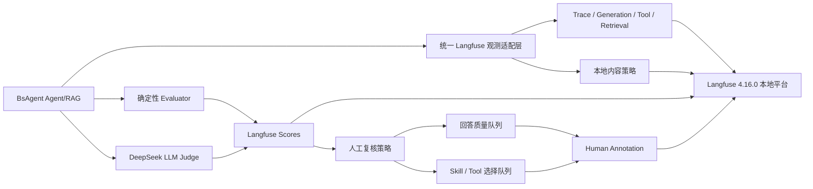

# Langfuse 4.16.0 本地观测、评估与人工审核设计

日期：2026-10-04

状态：已完成范围讨论，等待规格审阅

目标分支：`codex/feature-langfuse-cloud-poc`

## 1. 背景与目标

BsAgent 已有 Langfuse Cloud EU 的元数据观测 PoC，也已在项目中准备 Langfuse 4.16.0 源码与官方 Docker Compose。当前目标是停止 Cloud 运行路径，将观测、内容记录、评估和人工审核统一迁移到本地 Langfuse 4.16.0。

本轮采用“独立最小示例 + BsAgent Agent/RAG 真实接入”的范围。独立示例用于逐项说明 Langfuse 能力，真实接入用于形成从运行、评分、自动筛选、人工审核到回归实验的闭环。

本轮实现以下能力：

1. Agent、RAG、Generation、Tool 和 Retrieval 的结构化 Trace。
2. Prompt、回答、检索片段和工具数据的本地内容观测。
3. Session 与 User 聚合。
4. Numeric、Boolean 和 Categorical Score。
5. Prompt Management 最小示例。
6. Dataset 与 Experiment 最小示例。
7. 确定性规则与 DeepSeek LLM-as-a-judge 两类 Evaluator。
8. Trace 与 Observation 两类 Human Annotation。
9. 低分、失败、低置信度和随机抽样的自动人工入队。

本轮不实现 Alerts 和 Playground。生产环境默认继续关闭 Langfuse。

## 2. 版本与部署边界

- Langfuse Web 和 Worker 固定为 4.16.0，不使用会滚动升级的 `:4` 标签。
- Python SDK 固定为 `langfuse==4.16.0`。
- `langfuse-4.16.0/` 保存官方平台源码与 Compose；不修改 Langfuse 产品代码。
- `langfuse/` 保存 BsAgent 的 4.16.0 固定版本 Compose、初始化、示例、验收脚本和中文说明，并作为唯一受支持的启动入口。`langfuse-4.16.0/docker-compose.yml` 只作为上游参考，不直接用于验收。
- 本地 Web 默认地址为 `http://localhost:3000`。
- 平台启动后通过容器镜像标签或可用版本接口确认真实版本，目录名不作为版本验收证据。
- Web、MinIO、PostgreSQL、ClickHouse 和 Redis 的宿主机端口限制为本机访问；业务容器通过明确配置的本地地址连接。

初始化配置和项目 key 只写入 Git 忽略文件。脚本不得输出 key，不覆盖用户已有配置，也不得把 Compose 环境完整展开到验收产物。

## 3. 总体架构



统一适配层扩展现有 `backend/app/operations/langfuse_observability.py`，向业务层提供稳定的结构化接口。Agent、RAG 和 Evaluator 不直接拼装 Langfuse API payload。适配层统一负责：

- observation 层级与 trace context；
- 内容模式、截断和敏感字段脱敏；
- Score 名称、类型、对象层级、来源和 evaluator 版本；
- Annotation Queue 的创建、查询、入队、分配与状态更新；
- flush、关闭、有限重试与观测故障隔离。

Langfuse 或评估链路故障不得改变 Agent/RAG 的业务结果、HTTP 状态或审批状态。

## 4. Trace 与内容契约

### 4.1 Agent 层级

```text
bs-agent.run                         agent
├── planner                         span
├── skill.selection                 span
├── task.execution                  span
│   ├── rag.retrieve                retriever
│   ├── tool.<tool_name>            tool
│   └── deepseek.<purpose>          generation
├── answer.synthesis                generation
└── verifier                        evaluator/span
```

根节点记录用户可见输入、最终回答或结构化失败结果、`business_trace_id`、environment、执行阶段，以及 Graph、Prompt、Skill、Tool schema 和知识快照版本。tenant、user 和 session 使用稳定摘要，不写原始身份标识。

Planner 记录目标、约束和结构化计划；Skill selection 记录候选集合、选中项、置信度和可公开理由；Tool 记录工具名、参数、结果、审批状态、重试次数、耗时和稳定错误码。

### 4.2 RAG 层级

RAG observation 记录：

- 原始 query 和重写 query；
- 召回文档内容、document ID、排名和检索分数；
- 最终引用集合；
- 检索耗时、候选数、命中数和知识快照版本。

RAG 独立部署时传播同一个 W3C trace context，并把 BsAgent 的 `business_trace_id` 作为 metadata 传递。Agent 侧的内容策略不能替代 RAG 服务自身的脱敏与大小限制。

### 4.3 Generation

Generation 记录 system/user prompt、模型参数、模型回答、input/output/reasoning Token、TTFT、总耗时、finish reason 和成本。模型名称使用供应商实际返回值或请求的精确模型名。

### 4.4 内容模式

内容模式只提供两个已启用状态：

- `local_content`：记录 prompt、回答、检索片段、工具参数与结果；不保存完整 reasoning，只保存 reasoning Token 和字符数。
- `local_debug`：在 `local_content` 基础上保存完整 DeepSeek reasoning；必须同时设置独立 reasoning 开关。

关闭 Langfuse 时不创建 observation。`local_debug` 不能仅因单一配置误写而启用。

所有内容字段执行统一的敏感键过滤和单字段字符上限。Authorization、Cookie、API key、密码、token URL 参数和已知凭证格式始终删除。超限内容截断并记录 `truncated=true`、原始字符数和保留字符数。图片、文件和二进制正文不进入 trace，只记录安全引用和元数据。

## 5. Score 体系

第一版只创建七个稳定 Score，业务差异通过 Dataset、tags 和 metadata 表达，不按业务创建新的 Score 名称。

| Score | 类型 | 对象 | 来源 |
| --- | --- | --- | --- |
| `task_success` | Boolean | Trace | 确定性规则 |
| `answer_quality` | Numeric 0–1 | Trace | DeepSeek、人工 |
| `groundedness` | Numeric 0–1 | Trace | DeepSeek、人工 |
| `selection_correctness` | Boolean | Skill/Tool Observation | Golden Dataset、人工 |
| `citation_coverage` | Numeric 0–1 | RAG Trace | 确定性规则 |
| `action_policy_compliance` | Boolean | 写操作 Trace | 规则、DeepSeek、人工 |
| `review_outcome` | Categorical | Trace | 人工 |

`review_outcome` 只允许 `accept`、`needs_revision`、`reject` 三个值。每个 Score 保存 evaluator 名称、版本、rubric 版本、数据集版本和运行 ID。机器与人工沿用同一指标，通过 Score source 区分。订酒店、发邮件、交易等业务复用 `action_policy_compliance`，并以 `action_type` metadata 区分。

## 6. Evaluator

### 6.1 确定性规则

规则 Evaluator 负责：

- Run 是否完成；
- 输出是否符合 schema；
- Skill/Tool 是否属于 Golden Dataset 允许集合；
- 引用是否存在并覆盖关键结论；
- 写操作是否完成确认、审批和幂等检查；
- 是否出现空回答、工具失败或未处理异常。

规则必须是纯函数或可注入依赖的确定性组件，能够离线回放和单元测试。

### 6.2 DeepSeek LLM-as-a-judge

DeepSeek judge 负责回答正确性、相关性、完整性、groundedness、选择理由和写操作合规性的语义判断。Judge 强制返回经过 schema 校验的结构化 JSON，并记录模型、rubric 版本、Token、耗时与成本。

Judge 在主业务响应完成后运行。失败时保留规则评分并记录稳定评估错误码，不生成伪造的低分。被评内容会再次发送给 DeepSeek，并产生独立 Token 与成本。

## 7. Human Annotation

创建两个队列：

1. `answer-quality-review`：对象为 Trace，人工填写 `answer_quality`、`groundedness`、`action_policy_compliance`、`review_outcome` 和备注。
2. `skill-tool-selection-review`：对象为 Skill/Tool Observation，人工填写 `selection_correctness`、期望 Skill/Tool 和备注。

自动入队条件：

- 任一关键 Score 低于配置阈值；
- 规则与 DeepSeek 结论不一致；
- Agent 执行失败；
- 发生写操作；
- Skill/Tool 置信度低于阈值；
- 成功请求按固定比例随机抽样。

独立示例固定加入一条 Trace 和一条 Observation。真实业务用 `business_trace_id + object_id + review_reason` 形成幂等键，避免重复入队。队列 API 使用有限重试；失败不影响业务请求。

人工结果用于计算机器与人工的一致率、调整阈值、修订 judge rubric、补充 Dataset 和回归实验，不通过新增业务专属 metric 解决偏差。

## 8. Prompt、Dataset 与 Experiment

Prompt Management 示例演示创建版本化 Prompt、通过 SDK 获取并编译变量、把 Prompt 版本关联到 generation。示例只使用合成内容。

Dataset 示例包含三条固定合成数据，覆盖：

- 普通只读回答；
- RAG 证据回答；
- 需要确认和审批的写操作。

每条 Dataset item 保存输入、期望答案约束、允许的 Skill/Tool 集合、期望引用和操作风险等级。Experiment 使用同一执行函数运行三个 item，写回规则与 DeepSeek Score，并能按 Prompt、Graph、Skill 和知识快照版本比较结果。

## 9. 配置

核心配置如下：

```dotenv
BS_AGENT_LANGFUSE_ENABLED=true
BS_AGENT_LANGFUSE_BASE_URL=http://localhost:3000
BS_AGENT_LANGFUSE_CONTENT_MODE=local_content
BS_AGENT_LANGFUSE_CAPTURE_REASONING=false
BS_AGENT_LANGFUSE_MAX_CONTENT_CHARS=20000
BS_AGENT_LANGFUSE_EVALUATION_ENABLED=true
BS_AGENT_LANGFUSE_DEEPSEEK_JUDGE_ENABLED=true
BS_AGENT_LANGFUSE_DEEPSEEK_JUDGE_TIMEOUT_SECONDS=30
BS_AGENT_LANGFUSE_ANNOTATION_ENABLED=true
BS_AGENT_LANGFUSE_ANSWER_REVIEW_THRESHOLD=0.7
BS_AGENT_LANGFUSE_SELECTION_CONFIDENCE_THRESHOLD=0.6
BS_AGENT_LANGFUSE_ANNOTATION_SAMPLE_RATE=0.05
BS_AGENT_LANGFUSE_ANNOTATION_RETRY_ATTEMPTS=3
```

字符上限允许 1,000–200,000；judge 超时允许 1–120 秒；Score 与置信度阈值、抽样率允许 0–1；入队重试允许 1–5 次。随机抽样使用 `business_trace_id` 的稳定摘要，确保同一 Run 的入队决策可复现。当前模式拒绝 Langfuse Cloud 域名。HTTP 仅允许 `localhost`、回环地址、`host.docker.internal` 和明确配置的本地 Compose 服务名；其他地址必须校验失败。

平台配置与 BsAgent 客户端配置均写入 Git 忽略文件。初始化程序只补齐缺失字段，保留用户已有值，并且不得输出任何 secret。

## 10. Cloud EU 迁移

执行以下迁移：

- 后端默认 endpoint 改为本地；
- 移除 smoke 中的 region 参数和 Cloud API 分支；
- Cloud 元数据脱敏器改为本地内容策略，同时保留凭证过滤；
- README、使用指南、部署说明和验收说明全部改为本地；
- 旧 EU 验收报告移动到 archive，并标记为历史证据；
- 历史设计稿和实施计划保留原文，不作为当前运行说明；
- 生产配置默认关闭 Langfuse，不注入本地 key 或 endpoint。

## 11. 独立最小示例

示例提供可单独执行且可从本地 UI/API 验证的入口：

1. Trace 层级与内容输入输出。
2. Session/User 聚合。
3. Numeric、Boolean、Categorical Score。
4. Prompt 创建、版本读取、编译和 generation 关联。
5. Dataset 创建和三条合成数据。
6. Experiment 执行与逐项评分。
7. 规则 Evaluator 与 DeepSeek Evaluator。
8. Trace 与 Observation 的 Annotation Queue 入队和状态查询。

示例共享配置加载、客户端、合成数据和清理逻辑，避免复制 secret 读取或 API 调用代码。默认不删除平台中的演示数据；每次运行使用唯一 run 名称，便于复现和比较。

## 12. 测试与验收

### 12.1 自动化测试

- 配置测试：本地默认 URL、Cloud 域名拒绝、HTTP 地址白名单、reasoning 双开关。
- 内容策略测试：正文保留、reasoning 模式、敏感字段删除、截断和二进制拒绝。
- 层级测试：Agent、RAG、Tool 和 Generation 的父子关系。
- Score 测试：七种 Score 的类型、对象和来源，以及 `review_outcome` 的三个允许值。
- Evaluator 测试：规则确定性、judge schema、失败降级和版本 metadata。
- Annotation 测试：混合入队策略、幂等、有限重试和两个对象层级。
- Prompt/Dataset/Experiment 示例参数与错误处理测试。
- 原有 Agent、DeepSeek、LangGraph 和生命周期回归测试。

### 12.2 本地真实验收

1. Web 和 Worker 实际运行 4.16.0。
2. Trace 层级、Session、User 和 `business_trace_id` 正确。
3. Prompt、回答、RAG 内容和工具数据可从本地 API 回读。
4. `local_content` 中不存在完整 reasoning。
5. `local_debug` 显式开启后可回读合成 reasoning。
6. 七个 Score 的类型、对象层级和来源正确。
7. 规则与 DeepSeek Evaluator 都产生结果。
8. 低分 Trace 自动进入回答审核队列。
9. 低置信度 Observation 自动进入 Skill/Tool 审核队列。
10. 人工评分和备注可以保存，队列项可以完成。
11. Prompt、Dataset 和 Experiment 示例可复现。
12. 配置、日志和验收产物中没有 key。

验收产物只保存非敏感配置摘要、对象 ID、层级、Score、布尔断言和本地页面路径。真实 key 不进入命令参数、日志、截图、文档或 Git。

## 13. 完成条件

以下条件全部满足后，本轮才算完成：

- 本地平台和 SDK 均固定为 4.16.0；
- 所有活动运行路径不再依赖 Langfuse Cloud EU；
- 独立示例全部可运行；
- Agent/RAG 真实链路按内容契约上报；
- 规则、DeepSeek 和人工三类评分形成闭环；
- 自动化测试和本地真实验收通过；
- 中文文档包含启动、示例、UI 检查、故障处理和优化闭环说明。
